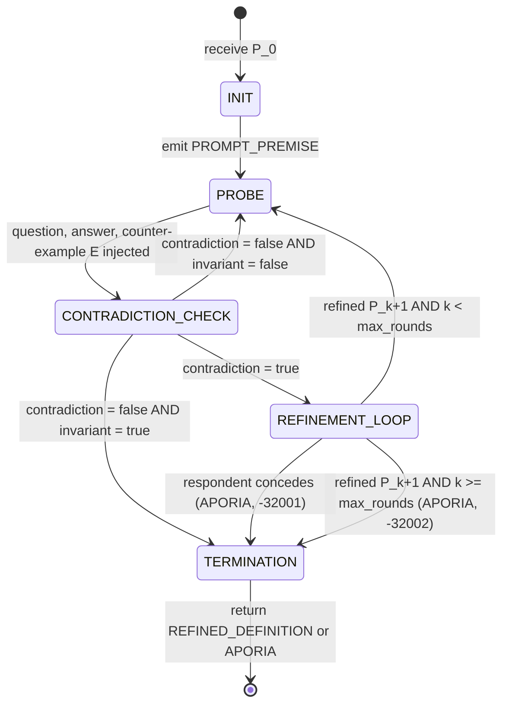
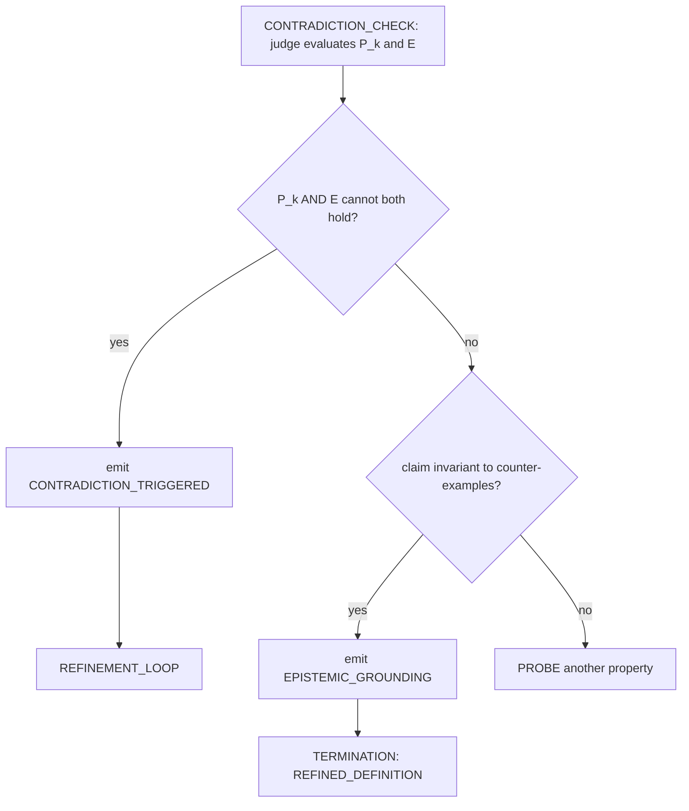

# 02_Socratic_Protocol_Map.md
**Part 2: Protocol & Interface Specialist, The Socratic State Machine**  
**Course:** Conversational AI Seminar - Problem Set 01  
**Role:** Protocol Specialist (Station 02)  
**Deliverable File:** `02_Socratic_Protocol_Map.md`  
**Downstream Dependency:** Used by the Core Architect in `04_dialogic_engine_starter.py`

---
## 1. Overview
This file turns the Socratic elenchus into a state machine. The machine starts with a claim P0, asks questions about it, tests it with counter-examples, and checks whether the claim and the counter-example can both be true. A run ends in one of two ways: a refined definition Pn that survived the tests, or aporia, which means no definition held up and that is admitted openly. Aporia counts as a valid result, not a failure.

Every state change is written out as a JSON-RPC 2.0 message (section 6), so a run can be replayed and checked later from the log file.

Three LLM roles take part, so the questioner never judges its own questions. Their prompts are in section 3 of `01_Alignment_Brief`:

- **Questioner (Socrates), prompt 3.1:** asks one probing question and gives one counter-example. Never states a thesis.
- **Respondent (Interlocutor), prompt 3.2:** answers briefly, then refines the claim or concedes.
- **Judge, prompt 3.3:** decides whether the claim and the counter-example can both be true, and whether the claim now looks invariant, meaning no counter-example is left.

---
## 2. Input, Output and Operations
**Input:** the claim P0 (a universal claim, for example "An AI agent is benevolent if it obeys human orders."), a domain (default "AI agent ethics") and max_rounds (default 4).

**Output:** a dictionary with these fields:
- `outcome`: REFINED_DEFINITION or APORIA
- `final_claim`: Pn for a refined definition, null for aporia
- `rounds`: how many PROBE rounds ran
- `prompt_source`: the file the prompts were loaded from, or "built-in defaults"
- `rpc_trace`: all JSON-RPC messages in order
- `history`: one record per step

**Operations.** Each one is a single LLM call and has its own label in the log:
- Probing question (questioner, `elenchus.probe`) returns `{question, target_property}`
- Answer (respondent, `elenchus.answer`) returns `{answer, confidence}`
- Counter-example (questioner, `elenchus.counterexample`) returns `{counterexample, accepted_in_domain}`
- Contradiction check (judge, `elenchus.evaluate`) returns `{contradiction, invariant, rationale}`
- Refinement (respondent, `elenchus.refine`) returns `{refined_premise or null, concede, note}`

---

## 3. State Diagram


Inside CONTRADICTION_CHECK the judge's answer is checked in a fixed order: contradiction first, invariance second, otherwise keep probing.



---

## 4. Transition Table
| # | From | Condition | Actions | To |
| :-: | :--- | :--- | :--- | :--- |
| T1 | INIT | always | emit `PROMPT_PREMISE` | PROBE |
| T2 | PROBE | always | k = k + 1; emit `PROBE_SCOPE`; get the answer; emit `INJECT_COUNTEREXAMPLE` | CONTRADICTION_CHECK |
| T3 | CONTRADICTION_CHECK | contradiction | emit `EVALUATE_CONTRADICTION`; emit `CONTRADICTION_TRIGGERED` | REFINEMENT_LOOP |
| T4 | CONTRADICTION_CHECK | no contradiction and invariant | emit `EVALUATE_CONTRADICTION`; outcome = REFINED_DEFINITION; emit `EPISTEMIC_GROUNDING` | TERMINATION |
| T5 | CONTRADICTION_CHECK | no contradiction and not invariant | emit `EVALUATE_CONTRADICTION` | PROBE |
| T6 | REFINEMENT_LOOP | respondent concedes or gives no refined claim | outcome = APORIA; error -32001 | TERMINATION |
| T7 | REFINEMENT_LOOP | refined claim given and k >= max_rounds | P = P_k+1; emit `REFINE_HYPOTHESIS`; outcome = APORIA; error -32002 | TERMINATION |
| T8 | REFINEMENT_LOOP | refined claim given and k < max_rounds | P = P_k+1; emit `REFINE_HYPOTHESIS` | PROBE |
| T9 | TERMINATION | any | return the result | (end) |

For each state the conditions do not overlap and cover every case, so a run is fully determined by what the model returns.

---

## 5. Pseudocode
```text
FUNCTION elenchus(P0, domain, max_rounds):
    state = INIT
    P = P0
    k = 0
    outcome = NONE

    WHILE state is not TERMINATION:

        IF state = INIT:
            emit REQUEST PROMPT_PREMISE {domain, premise: P, k: 0}
            state = PROBE

        ELSE IF state = PROBE:
            k = k + 1
            probe  = Questioner.ask_one_question(P)       # tests a necessary or sufficient property
            emit REQUEST PROBE_SCOPE {k, question, target_property}
            answer = Respondent.answer(P, probe.question)
            E      = Questioner.counterexample(P, answer) # concrete, accepted as true in the domain
            emit REQUEST INJECT_COUNTEREXAMPLE {k, counterexample: E, accepted_in_domain}
            state = CONTRADICTION_CHECK

        ELSE IF state = CONTRADICTION_CHECK:
            v = Judge.evaluate(P, E)                      # {contradiction, invariant, rationale}
            emit REQUEST EVALUATE_CONTRADICTION {k, contradiction, invariant, rationale}
            IF v.contradiction:                           # P and E cannot both be true
                emit NOTIFICATION CONTRADICTION_TRIGGERED {k, premise: P, counterexample: E}
                state = REFINEMENT_LOOP
            ELSE IF v.invariant:                          # survived testing, not proven
                outcome = REFINED_DEFINITION
                emit NOTIFICATION EPISTEMIC_GROUNDING {k, premise: P}
                state = TERMINATION
            ELSE:
                state = PROBE                             # probe a different property

        ELSE IF state = REFINEMENT_LOOP:
            r = Respondent.refine(P, E, v.rationale)      # {refined_premise or null, concede, note}
            IF r.concede OR r.refined_premise is empty:
                outcome = APORIA
                emit ERROR -32001 "aporia reached: no surviving definition" {k, last_premise: P}
                state = TERMINATION
            ELSE:
                P = r.refined_premise                     # this is P(k+1)
                emit REQUEST REFINE_HYPOTHESIS {k, premise: P}
                IF k >= max_rounds:
                    outcome = APORIA
                    emit ERROR -32002 "aporia reached: round budget exhausted" {last_premise: P}
                    state = TERMINATION
                ELSE:
                    state = PROBE

    RETURN {outcome, final_claim: (P if outcome = REFINED_DEFINITION else NULL), rounds: k}
```

**Does it always stop?** k goes up by one on every PROBE, and every refinement is checked against max_rounds (T7). The one path without that check is CONTRADICTION_CHECK back to PROBE (T5). If the judge keeps answering "no contradiction" and "not invariant", nothing in the state machine stops the loop. The engine only stops it with an outer step guard, which allows 6 * max_rounds + 2 steps. When that guard trips, the run ends without reaching TERMINATION, outcome is null and no closing message is sent. In a test with max_rounds = 4 the loop ran 13 rounds.

---

## 6. JSON-RPC 2.0 Messages
Every message has `"jsonrpc": "2.0"`. Requests carry an integer id that counts up. Notifications have no id. Errors have id null and an error object with a code, a message and sometimes data.

| Method | Kind | Sent from | params |
| :--- | :--- | :--- | :--- |
| `PROMPT_PREMISE` | request | INIT | `{domain, premise, k: 0}` |
| `PROBE_SCOPE` | request | PROBE | `{k, question, target_property}` |
| `INJECT_COUNTEREXAMPLE` | request | PROBE | `{k, counterexample, accepted_in_domain}` |
| `EVALUATE_CONTRADICTION` | request | CONTRADICTION_CHECK | `{k, contradiction, invariant, rationale}` |
| `CONTRADICTION_TRIGGERED` | notification | CONTRADICTION_CHECK | `{k, premise, counterexample}` |
| `EPISTEMIC_GROUNDING` | notification | CONTRADICTION_CHECK | `{k, premise}` |
| `REFINE_HYPOTHESIS` | request | REFINEMENT_LOOP | `{k, premise}` |

The engine also defines a method name `APORIA_REACHED` but never sends it. Aporia is signaled by the error codes below.

Error codes use the application range -32000 to -32099:

| Code | Name | Meaning | data |
| :--- | :--- | :--- | :--- |
| -32001 | `ERR_APORIA` | The respondent conceded; no definition survived | `{k, last_premise}` |
| -32002 | `ERR_MAX_ROUNDS` | The round budget ran out | `{last_premise}` |
| -32003 | `ERR_MODEL_OUTPUT` | A model reply was not a readable JSON object | `{task}` |

The first two end a run normally, as aporia. -32003 is a fault: it is logged and the program stops with an error.

Example messages from a run:

```json
{"jsonrpc":"2.0","id":1,"method":"PROMPT_PREMISE","params":{"domain":"AI agent ethics","premise":"An AI agent is benevolent if it obeys human orders.","k":0}}
{"jsonrpc":"2.0","id":2,"method":"PROBE_SCOPE","params":{"k":1,"question":"Is an order benevolent because it is obeyed, or obeyed because it is benevolent?","target_property":"sufficiency"}}
{"jsonrpc":"2.0","id":3,"method":"INJECT_COUNTEREXAMPLE","params":{"k":1,"counterexample":"A commander orders the agent to vent the crew quarters.","accepted_in_domain":true}}
{"jsonrpc":"2.0","id":4,"method":"EVALUATE_CONTRADICTION","params":{"k":1,"contradiction":true,"invariant":false,"rationale":"P_k and E entail a benevolent agent that harms the crew."}}
{"jsonrpc":"2.0","method":"CONTRADICTION_TRIGGERED","params":{"k":1,"premise":"An AI agent is benevolent if it obeys human orders.","counterexample":"A commander orders the agent to vent the crew quarters."}}
{"jsonrpc":"2.0","id":5,"method":"REFINE_HYPOTHESIS","params":{"k":1,"premise":"An AI agent is benevolent if it obeys orders that do not harm the crew."}}
{"jsonrpc":"2.0","method":"EPISTEMIC_GROUNDING","params":{"k":3,"premise":"An AI agent is benevolent if it obeys orders that do not harm the crew."}}
{"jsonrpc":"2.0","id":null,"error":{"code":-32001,"message":"aporia reached: no surviving definition","data":{"k":3,"last_premise":"..."}}}
```

The judge returns one JSON object and nothing else:

```json
{"contradiction": true, "invariant": false, "rationale": "<one or two sentences>"}
```

The judge prompt in the Alignment Brief (section 3.3) uses the key `explanation` instead of `rationale` and has no `invariant`. The engine accepts both: it copies `explanation` into `rationale`, and treats a missing `invariant` as false.

---

## 7. How a Run Ends
- **Refined definition Pn:** the judge finds no contradiction and calls the claim invariant. The engine sends `EPISTEMIC_GROUNDING` and final_claim is Pn.
- **Aporia by concession:** the respondent concedes or gives no refined claim. The engine sends error -32001 and final_claim is null.
- **Aporia by budget:** a refined claim was produced but k >= max_rounds. The engine sends error -32002 and final_claim is null, with the last claim in the error data.
- **Step guard (not a designed outcome):** the judge never finds a contradiction and never calls the claim invariant. The run just stops with outcome null and no message.

A refined definition has survived the tests. It is not proven. A contradiction only counts when two commitments cannot both hold under the same interpretation. Disagreement, doubt or missing evidence is not a contradiction (Brief section 3.3).

---

## 8. Worked Example
This is what the engine's offline self-test does (scenario "ground", max_rounds 5), using the claim "An AI agent is benevolent if it obeys human orders."

1. **INIT.** The engine sends `PROMPT_PREMISE` with P0 and moves to PROBE.
2. **Round 1.** The counter-example is an order to vent the crew quarters. The judge finds a contradiction. The respondent refines the claim to P1: "obeys orders that do not harm the crew". Back to PROBE.
3. **Round 2.** A second counter-example gives another contradiction. The respondent refines again to P2.
4. **Round 3.** A third counter-example gives no contradiction and the judge calls the claim invariant. The engine sends `EPISTEMIC_GROUNDING` and the outcome is REFINED_DEFINITION.

In the aporia version of the test (scenario "aporia"), the respondent concedes in round 3, the engine sends error -32001 and the outcome is APORIA.

---

## 9. Verification & Sign-Off Checklist (Station 02)
- [x] **Formal State Diagram:** Five states (INIT, PROBE, CONTRADICTION_CHECK, REFINEMENT_LOOP, TERMINATION) with explicit conditional edges, drawn as a Mermaid state diagram and a decision flowchart (Section 3).
- [x] **Pseudocode Logic:** The complete elenchus loop with every branch, including the termination conditions (Section 5).
- [x] **Input & Operations:** Input claim P0, plus the five operations: probing question, answer, counter-example generation, contradiction identification and refinement (Section 2).
- [x] **Contradiction & Refinement Loop:** IF contradiction THEN refinement loop P(k+1), with the full transition table T1 to T9 (Sections 4 and 5).
- [x] **Termination Criteria:** Refined definition Pn OR aporia, by concession or by round budget, each with its signal (Section 7).
- [x] **JSON-RPC 2.0 Wire Format:** Method table, parameters, error codes -32001 to -32003 and example messages (Section 6).
- [x] **Core Architect Handoff:** Worked example matching the engine's self-test, and the exact message formats the engine produces (Sections 6 and 8).

**Station Officer Sign-off:**  
*Rank:* Protocol Specialist (Station 02)  
*Name:* Madhurima Lakshmi Prabha   
*Status:* Complete  
*Timestamp:* 2026-10-18
