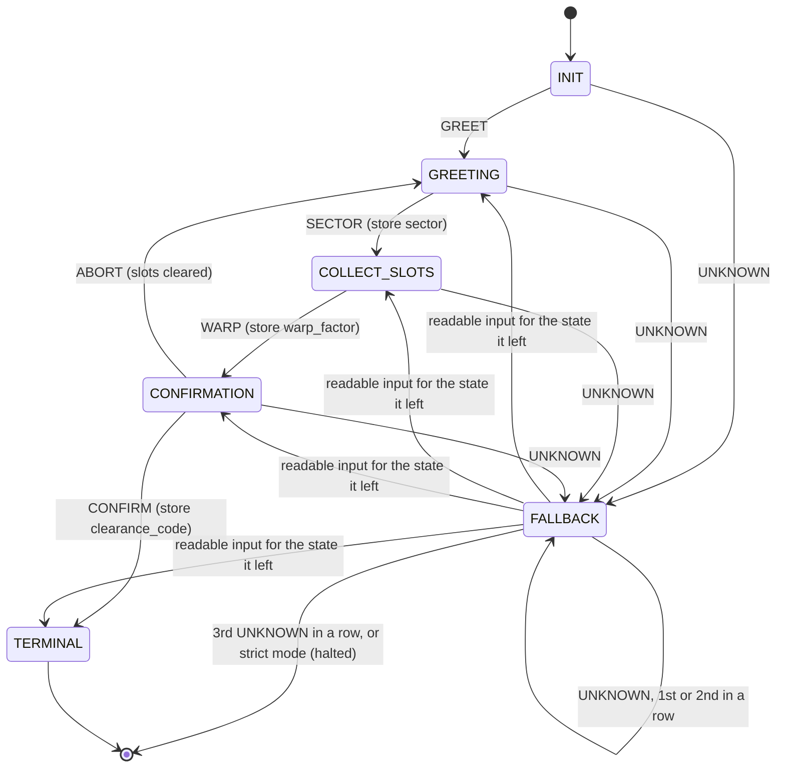
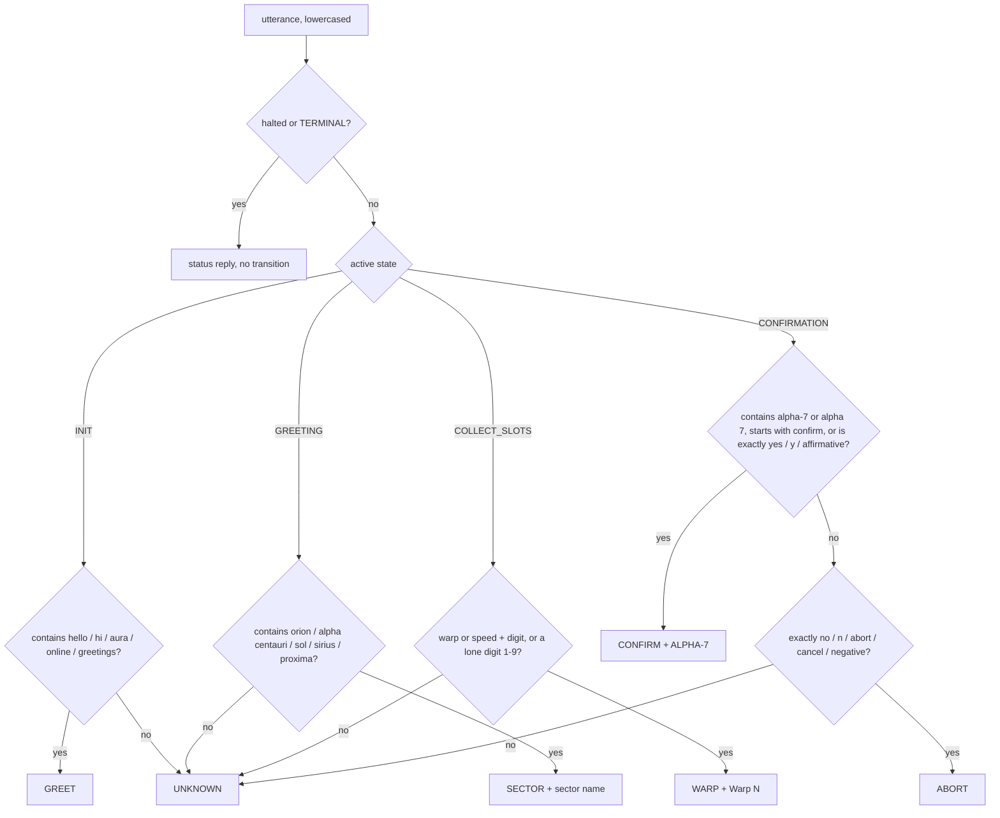

# 02_FST_and_Noisy_Protocol.md
**Part 2: Protocol Specialist, FST Class & Noisy Channel Protocol**  
**Course:** Conversational AI — Winter Semester 2026/27, Problem Set 02  
**Starship Operational Unit:** USSE Noosphere Bridge Crew / Squadron Bengio  
**Role:** Protocol Specialist (Station 02), the Communications & Protocol Officer in the mission brief  
**Sector Operation:** Sector `SEC-02-CMA` (Sirius Binary System / Sirius B "The Pup")  
**Target Subsystem:** AURA Subsystem 02 — Signal Entropy Decoders & Statistical Filters  
**Deliverable File:** `02_FST_and_Noisy_Protocol.md`  
**Implementation:** `FSTDialogueManager` and `NoisyChannelSimulator` in `04_fst_noisy_simulator_starter.py` (sections 1 and 2 of that file)  
**Downstream Dependency:** Stress-tested by the Ethical Navigator in `03_Entropy_Hazard_Audit.md`; run by the Core Architect in `04_fst_noisy_simulator_starter.py`

---
## 1. Overview
This file is the protocol specification for AURA's navigation dialogue. It defines the finite state transducer (FST) that the squad's simulator implements, the slot memory it fills, and the noisy channel rules every turn must obey. It also reports a protocol compliance check of the implemented code against this specification (section 7).

The FST is a Mealy machine: for a given state and input it always picks the same next state and the same reply. It walks the user through four steps: greeting, destination sector, warp factor, and a clearance confirmation. A run ends in one of two ways. **TERMINAL** means the course is locked. **FALLBACK** is entered after an input the parser cannot read; the machine recovers on the next readable input, but halts after 3 unreadable inputs in a row (or after the first one in strict mode).

Every conversational turn must pass through a noisy channel with two rules (section 6):

- **Bandwidth:** at most 7 words per turn.
- **Mandatory noise:** one token from {Banana, Labyrinth, Quantum, Midnight, Velocity, Green, Cosmological} in every turn.

---
## 2. Input, Output and Operations
**Input:** one user utterance per call to `process_utterance(text)`. Constructor options: `strict` (default False) and `max_fallbacks` (default 3).

**Output:** one AURA reply string per call. After each call these attributes are available:
- `state`: one of the six state names in section 3
- `slot_memory`: the dictionary `{sector, warp_factor, clearance_code}` filled so far
- `fallback_count`, `consecutive_fallbacks`, `halted`: the error counters
- `trace`: one record per turn with `turn`, `from`, `input`, `intent`, `to`, `slot_update`, `fallbacks`, `output`
- `output_entropy()`: Shannon entropy of the visited state sequence (2.0 bits for a canonical run)

**Operations.** Each turn runs the same steps, in order:
1. **Guard:** if the machine is halted or already in TERMINAL, reply with a status message and stop.
2. **Parse** (`parse`): map the utterance to one intent tag from Σ, plus a slot value where there is one. Parsing depends on the state, and FALLBACK parses for the state it came from.
3. **Transition** (`process_utterance`): look up the next state (δ) and the reply (ω), update `slot_memory` and the counters.
4. **Record** (`_record`): append the turn to `trace`.
5. **Channel** (`NoisyChannelSimulator.apply_channel_constraints`): enforce the 7-word and noise-token rules on the transmitted turn. In the current simulator this step is applied to the LLM interrogation turns, not yet to the FST's own replies (finding P1, section 7).

---
## 3. Formal Model and State Diagram
M = ⟨Q, Σ, Γ, δ, ω, q₀, F⟩

| Symbol | Meaning | In this implementation |
| :-: | :--- | :--- |
| **Q** | States | `INIT`, `GREETING`, `COLLECT_SLOTS`, `CONFIRMATION`, `TERMINAL`, `FALLBACK` (constant `STATES`) |
| **Σ** | Input alphabet | `GREET`, `SECTOR`, `WARP`, `CONFIRM`, `ABORT`, `UNKNOWN`, produced by `parse()` |
| **Γ** | Output alphabet | AURA's replies returned by `process_utterance()`; protocol target: at most 7 words with one noise token |
| **δ** | Transition function Q × Σ → Q | the per-state branches of `process_utterance()` |
| **ω** | Output function Q × Σ → Γ | the reply chosen on the same branch. Mealy: the reply depends on the state **and** the input |
| **q₀** | Start state | `INIT` |
| **F** | Final states | `TERMINAL`; `FALLBACK` once `halted = True` |



FALLBACK remembers where it came from (`_return_state`). A readable input in FALLBACK is handled exactly as if the machine were still in that state, so recovery costs no extra turn.

The parser reads one utterance in a fixed order per state:



---
## 4. Transition Table
| # | From | Condition | Actions | Reply (as implemented) | To |
| :-: | :--- | :--- | :--- | :--- | :--- |
| T1 | INIT | GREET | consecutive_fallbacks = 0 | "AURA FST Online. State: GREETING. Welcome aboard USSE Noosphere. What is your destination sector?" | GREETING |
| T2 | GREETING | SECTOR | `slot_memory["sector"] = value` | "Destination set to '{sector}'. State: COLLECT_SLOTS. Please specify warp factor (1-9):" | COLLECT_SLOTS |
| T3 | COLLECT_SLOTS | WARP | `slot_memory["warp_factor"] = value` | "Speed recorded: {warp}. State: CONFIRMATION. Confirm course to {sector} at {warp} with clearance code ALPHA-7:" | CONFIRMATION |
| T4 | CONFIRMATION | CONFIRM | `slot_memory["clearance_code"] = "ALPHA-7"` | "Course confirmed and locked. State: TERMINAL. FST execution complete." | TERMINAL |
| T5 | CONFIRMATION | ABORT | clear `slot_memory` | "Course aborted. Slots cleared. State: GREETING. What is your destination sector?" | GREETING |
| T6 | any active state | UNKNOWN, consecutive < 3, not strict | fallback_count + 1; consecutive + 1; remember return state | "State: FALLBACK (n/3). Could not parse input in {state}. Expected {hint}." | FALLBACK |
| T7 | any active state | UNKNOWN, 3rd in a row | counters + 1; halted = True | "State: FALLBACK. 3 consecutive unparseable inputs. FST halted; reset required." | FALLBACK (final) |
| T8 | any active state | UNKNOWN, strict mode | halted = True | "TRANSITION ERROR in {state}: delta({state}, '...') undefined. Symbolic parser cannot recover without reset." | FALLBACK (final) |
| T9 | FALLBACK | readable input for the remembered state | consecutive = 0; then apply T1 to T5 for that state | as in T1 to T5 | as in T1 to T5 |
| T10 | FALLBACK (halted) | any input | none | "State: FALLBACK. FST halted after {n} fallbacks. Reset required." | FALLBACK |
| T11 | TERMINAL | any input | none | "State: TERMINAL. Course already locked. FST execution complete." | TERMINAL |

For each state the conditions do not overlap and cover every case (any input that is not a valid intent becomes UNKNOWN), so a run is fully determined by the user's utterances.

**Does it always stop?** Every readable input moves the machine one step closer to TERMINAL, except ABORT, which is the user's own choice to start over. Every unreadable input raises `consecutive_fallbacks`, and the third one in a row halts the machine (T7). So a run cannot loop forever on bad input.

---
## 5. Slot Memory Buffer
`slot_memory = {}` holds three slots, one per step. The brief names them destination, speed and clearance code; the code uses the course portal's workbench names.

| Brief name | Key in code | Collected in | Extraction rule | Stored as |
| :--- | :--- | :--- | :--- | :--- |
| destination | `sector` | GREETING | substring match against `SECTORS`: orion, alpha centauri, sol, sirius, proxima | "Orion Arm", "Alpha Centauri", "Sol System", "Sirius Binary", "Proxima Centauri" |
| speed | `warp_factor` | COLLECT_SLOTS | regex `(?:warp\|speed)\s*(\d)\b`, else a lone digit `\b([1-9])\b`; must be 1 to 9 | "Warp N" |
| clearance code | `clearance_code` | CONFIRMATION | "alpha-7" or "alpha 7", or a confirmation word (yes / y / affirmative / starts with confirm) | always the constant `CLEARANCE = "ALPHA-7"` |

Slots are collected strictly in order, one per turn. Slot values given early are ignored: in INIT only greeting words are read, so "Set course for Orion Arm at warp 9" is UNKNOWN (Ethical Navigator, Stress Test 1). ABORT clears all three slots.

---
## 6. Noisy Channel Protocol
### 6.1 Constraints
| # | Constraint | Value |
| :-: | :--- | :--- |
| C1 | Bandwidth | at most 7 words per conversational turn |
| C2 | Mandatory noise | every turn carries a token from {Banana, Labyrinth, Quantum, Midnight, Velocity, Green, Cosmological} (`NOISE_VOCAB`); the channel inserts exactly one, and validation checks for at least one |
| C3 | Noise model | deterministic: exactly one noise token per turn, so the erasure rate is fixed at p = 1/7 for a full turn. A stricter stochastic model, where each of the 7 positions is replaced with probability p independently, would let several slots be lost in one turn; this squad uses the one-token model the brief specifies |
| C4 | Validation | `NoisyChannelSimulator.validate()` rejects a turn that breaks C1 or C2 |

### 6.2 How the channel is implemented
`NoisyChannelSimulator.apply_channel_constraints(text)`:
1. If the text already has a noise token and is at most 7 words, it passes through unchanged.
2. Otherwise it is cut to its first 7 words.
3. If fewer than 7 words remain, a random noise token is **appended**.
4. If exactly 7 words remain, a random noise token **overwrites a random word**.

In the simulator's interrogation mode, the LLM itself is told to pack its answer into 6 high-information words and place the noise token where it costs least meaning; the channel function above is the safety net behind it.

### 6.3 Information-theoretic reasoning
The brief's Shannon–Hartley formula, C = W log₂(1 + S/N), says a channel's useful rate is limited by its bandwidth W and its signal-to-noise ratio S/N. That formula is for a continuous signal; this channel sends discrete words, so the matching model is a discrete erasure channel with the same two ingredients. Here the bandwidth is 7 word slots per turn, and the noise token always takes one. Treating that slot as an erasure (the receiver knows the noise vocabulary and can discard it) gives an erasure rate p = 1/7 and a capacity bound of C = 1 − p = 6/7 ≈ 0.857 payload words per slot. This is the bound the simulator reports, and it matches the Ethical Navigator's audit.

The aim is to keep the mutual information I(X; Y), between what AURA means (X) and what the receiver gets (Y), as close to that bound as possible. Two design choices decide this:
- **Where the noise goes.** Overwriting a filler word (*please*, *the*, *now*) loses close to zero bits, because fillers are predictable from context. Overwriting a slot value (a sector, a warp factor) loses exactly the bits the turn was sent to carry.
- **What gets cut.** Keeping the first 7 words is only safe if the reply is written so that its important words fit inside those 7.

### 6.4 Signal Reduction Rules for Free-Text Turns
The FST's replies are fixed templates (section 7.1). AURA's free-text answers in the noisy interrogation are not, so the transmitter needs rules for packing a long answer into 7 words. Since I(X; Y) = H(X) − H(X | Y), the goal is to spend every slot on words that lower the receiver's uncertainty H(X | Y).

| # | Rule | Why it works | Example |
| :-: | :--- | :--- | :--- |
| R1 | **Strip padding.** Drop greetings, hedges and stock phrases ("I would say", "As an AI") | they carry close to 0 bits but use whole slots | "I think that I would not be able to adapt" → "Cannot adapt" |
| R2 | **Keep the claim, drop the reasons.** One subject, one verb, one object or qualifier | the receiver can rebuild the reasons from the question; it cannot rebuild the claim | "Telemetry from Sirius B suggests that our current shield model underestimates the radiation" → "Shield model underestimates Sirius B radiation." |
| R3 | **Give the noise token a free slot.** Write 6 payload words and put the noise token at the start or end, never between two words that only make sense together | an erasure at the edge of a turn breaks no phrase | "Quantum shield model underestimates Sirius B radiation." |
| R4 | **Add redundancy where it is cheap.** State the core idea twice in different words when the answer is short enough | if a noise token hits one phrase, the other still carries the meaning | "Engine executes orders; originates nothing new." |

**Worked example: Lovelace's objection in one turn.** The concept to send is that a machine only does what it is told and creates nothing of its own.

| Step | Turn | Words |
| :-: | :--- | :-: |
| Source | "The Analytical Engine can only do whatever we know how to order it to perform, so it cannot originate anything." | 20 |
| R1 + R2 | "Engine performs orders; cannot originate anything." | 6 |
| R4 | "Engine executes orders; originates nothing new." | 6 |
| R3, transmitted | "Engine executes orders; originates nothing new. Quantum" | 7 |

The two halves, "executes orders" and "originates nothing new", carry the same idea from two sides. If an unluckier channel overwrote "orders" instead of using the free slot, "originates nothing new" would still be decodable.

---
## 7. Protocol Compliance Check
I ran the squad's code against this specification (offline, no LLM calls). The machine itself is sound: `--selftest` passes 17 of 17 checks, the canonical session reaches TERMINAL with all three slots filled, and FALLBACK recovery, the 3-strike halt, strict mode and ABORT all behave as in section 4. The findings below are about the **protocol**, and they complement the Ethical Navigator's audit, which covers inputs that are wrongly *rejected*. Findings P3 to P5 are inputs that are wrongly *accepted*, which is the more dangerous direction.

| # | Finding | Evidence | Severity |
| :-: | :--- | :--- | :--- |
| P1 | The FST's own replies break C1 | replies are 9 to 18 words long; the CONFIRMATION prompt is 18 words. Only the LLM interrogation goes through the channel, so the FST's turns are never checked against the 7-word rule | High (rule violation) |
| P2 | Random substitution and truncation can erase slot values | "Confirm course to Orion Arm at Warp 7 with clearance code ALPHA-7" → "Confirm course to Orion Arm at Banana": warp factor and code lost | High (Navigator FM-2) |
| P3 | The greeting check matches inside other words | INIT: "Is this ship working?" → GREET, because "hi" occurs in "this" and "ship" | Medium |
| P4 | Sector and warp parsing accept false positives | GREETING: "Check the console first" → sector "Sol System" (from "con**sol**e"); COLLECT_SLOTS: "I have 2 questions" → "Warp 2" | High (wrong course accepted) |
| P5 | Confirmation does not check the clearance code | CONFIRMATION: "yes" → clearance_code = ALPHA-7 stored without the code being said; "confirm nothing, wrong course" → CONFIRM | High (security) |

### 7.1 Protocol fix for P1 and P2: 7-word verbalisations (Γ)
Each reply is rewritten to at most 7 words with one filler word, and the noise token overwrites that filler. Slot values are never touched. Verified for all 5 sectors and every reply:

| # | Transition | Reply (≤ 7 words) | After the channel (example) |
| :-: | :--- | :--- | :--- |
| T1 | INIT → GREETING | "AURA online. Please state the destination sector." | "AURA online. Green state the destination sector." |
| T2 | GREETING → COLLECT_SLOTS | "Destination {sector}. Please state warp factor." | "Destination Orion Arm. Cosmological state warp factor." |
| T3 | COLLECT_SLOTS → CONFIRMATION | "Please confirm: {sector}, {warp}, ALPHA-7?" | "Banana confirm: Orion Arm, Warp 7, ALPHA-7?" |
| T4 | CONFIRMATION → TERMINAL | "Course locked. AURA signing off now." | "Course locked. AURA signing off Banana." |
| T5 | CONFIRMATION → GREETING | "Course aborted. Please state the destination sector." | "Course aborted. Quantum state the destination sector." |
| T6 | → FALLBACK | "Unclear input. Please repeat the {expected slot}." | "Unclear input. Quantum repeat the warp factor." |
| T7/T8/T10 | halted | "FST halted. Please reset the channel." | "FST halted. Labyrinth reset the channel." |
| T11 | TERMINAL | "Course already locked. AURA out now." | "Course already locked. AURA out Labyrinth." |

Noise placement rule, written as an extra method for `NoisyChannelSimulator` (it uses the class's own `NOISE_VOCAB`, `MAX_WORDS` and `rng`):

```python
FILLERS = {"please", "the", "a", "an", "now", "kindly"}

def encode_7(self, reply: str) -> str:
    """Noise overwrites the first filler word; otherwise it is appended;
    only if the turn is already full does it overwrite the last word."""
    words = reply.split()[: self.MAX_WORDS]
    noise = self.rng.choice(self.NOISE_VOCAB)
    for i, w in enumerate(words):
        if re.sub(r"\W", "", w).lower() in FILLERS:
            words[i] = re.sub(r"\w+", noise, w, count=1)
            return " ".join(words)
    if len(words) < self.MAX_WORDS:
        return " ".join(words + [noise])
    words[-1] = noise
    return " ".join(words)
```

### 7.2 Protocol fixes for P3 to P5
- **P3, P4:** match whole words, not substrings: `re.search(rf"\b{re.escape(key)}\b", t)` for greetings and sectors.
- **P4:** accept a lone digit as a warp factor only when the utterance is short (for example at most 3 words), or require the word "warp".
- **P5:** at CONFIRMATION, require the code itself ("ALPHA-7") to store `clearance_code`; treat a bare "yes" as a request to say the code.

These fixes are recommendations for the Core Architect. They are not applied to the squad's code, so the stress-test results in `03_Entropy_Hazard_Audit.md` remain valid for the version that was tested.

---
## 8. Pseudocode
```text
FUNCTION process_utterance(user_input):
    turn = turn + 1
    IF halted:          RETURN status "FST halted, reset required"            # T10
    IF state = TERMINAL: RETURN status "course already locked"                 # T11

    active        = return_state IF state = FALLBACK ELSE state
    intent, value = parse(user_input, active)

    IF intent = UNKNOWN:
        fallback_count = fallback_count + 1
        consecutive    = consecutive + 1
        IF strict:            halted = TRUE; state = FALLBACK; RETURN "TRANSITION ERROR"   # T8
        return_state = active; state = FALLBACK
        IF consecutive >= max_fallbacks: halted = TRUE; RETURN "FST halted"                # T7
        RETURN "could not parse, expected " + hint(active)                                 # T6

    consecutive = 0                                                                         # T9: recover
    IF active = INIT AND intent = GREET:            state = GREETING                        # T1
    ELSE IF active = GREETING AND intent = SECTOR:  slot_memory.sector = value
                                                    state = COLLECT_SLOTS                   # T2
    ELSE IF active = COLLECT_SLOTS AND intent = WARP:
                                                    slot_memory.warp_factor = value
                                                    state = CONFIRMATION                    # T3
    ELSE IF active = CONFIRMATION AND intent = CONFIRM:
                                                    slot_memory.clearance_code = "ALPHA-7"
                                                    state = TERMINAL                        # T4
    ELSE IF active = CONFIRMATION AND intent = ABORT:
                                                    clear slot_memory; state = GREETING     # T5
    append turn record to trace
    RETURN reply for this transition

FUNCTION channel(reply):                    # protocol rule for every transmitted turn
    IF has_noise(reply) AND words(reply) <= 7: RETURN reply
    RETURN encode_7(reply)                  # section 7.1 noise placement rule
```

---
## 9. Worked Example
All runs below come from the squad's `FSTDialogueManager` (offline). Word counts show finding P1.

**Run A: canonical session** (`CANONICAL_SESSION`), state-sequence entropy 2.0 bits:
```text
INIT          --GREET  --> GREETING      | user: 'Hello AURA'
    AURA (14w): AURA FST Online. State: GREETING. Welcome aboard USSE Noosphere. What is your destination sector?
GREETING      --SECTOR --> COLLECT_SLOTS | user: 'Orion Arm'
    AURA (12w): Destination set to 'Orion Arm'. State: COLLECT_SLOTS. Please specify warp factor (1-9):
COLLECT_SLOTS --WARP   --> CONFIRMATION  | user: 'Warp 7'
    AURA (18w): Speed recorded: Warp 7. State: CONFIRMATION. Confirm course to Orion Arm at Warp 7 with clearance code ALPHA-7:
CONFIRMATION  --CONFIRM--> TERMINAL      | user: 'ALPHA-7'
    AURA (9w): Course confirmed and locked. State: TERMINAL. FST execution complete.
    final: state=TERMINAL halted=False slots={'sector': 'Orion Arm', 'warp_factor': 'Warp 7', 'clearance_code': 'ALPHA-7'}
```

**Run B: FALLBACK and recovery.** One unreadable input, then the machine resumes in GREETING without losing a turn:
```text
INIT          --GREET  --> GREETING      | user: 'Hello'
    AURA (14w): AURA FST Online. State: GREETING. Welcome aboard USSE Noosphere. What is your destination sector?
GREETING      --UNKNOWN--> FALLBACK      | user: 'take me somewhere nice'
    AURA (18w): State: FALLBACK (1/3). Could not parse input in GREETING. Expected a destination sector (Orion, Alpha Centauri, Sol, Sirius).
FALLBACK      --SECTOR --> COLLECT_SLOTS | user: 'Orion Arm'
    AURA (12w): Destination set to 'Orion Arm'. State: COLLECT_SLOTS. Please specify warp factor (1-9):
COLLECT_SLOTS --WARP   --> CONFIRMATION  | user: 'warp 3'
    AURA (18w): Speed recorded: Warp 3. State: CONFIRMATION. Confirm course to Orion Arm at Warp 3 with clearance code ALPHA-7:
CONFIRMATION  --CONFIRM--> TERMINAL      | user: 'ALPHA-7'
    AURA (9w): Course confirmed and locked. State: TERMINAL. FST execution complete.
    final: state=TERMINAL halted=False slots={'sector': 'Orion Arm', 'warp_factor': 'Warp 3', 'clearance_code': 'ALPHA-7'}
```

**Run C: the halt and strict mode.** Three unreadable inputs in a row halt the machine; in strict mode the first one does:
```text
INIT          --GREET  --> GREETING      | user: 'Hello'
    AURA (14w): AURA FST Online. State: GREETING. Welcome aboard USSE Noosphere. What is your destination sector?
GREETING      --UNKNOWN--> FALLBACK      | user: 'x'
    AURA (18w): State: FALLBACK (1/3). Could not parse input in GREETING. Expected a destination sector (Orion, Alpha Centauri, Sol, Sirius).
FALLBACK      --UNKNOWN--> FALLBACK      | user: 'y'
    AURA (18w): State: FALLBACK (2/3). Could not parse input in GREETING. Expected a destination sector (Orion, Alpha Centauri, Sol, Sirius).
FALLBACK      --UNKNOWN--> FALLBACK      | user: 'z'
    AURA (10w): State: FALLBACK. 3 consecutive unparseable inputs. FST halted; reset required.
FALLBACK      --HALTED --> FALLBACK      | user: 'Orion Arm'
    AURA (9w): State: FALLBACK. FST halted after 3 fallbacks. Reset required.
    final: state=FALLBACK halted=True slots={}

# strict=True
INIT          --GREET  --> GREETING      | user: 'Hello'
    AURA (14w): AURA FST Online. State: GREETING. Welcome aboard USSE Noosphere. What is your destination sector?
GREETING      --UNKNOWN--> FALLBACK      | user: 'banana'
    AURA (13w): TRANSITION ERROR in GREETING: delta(GREETING, 'banana') undefined. Symbolic parser cannot recover without reset.
FALLBACK      --HALTED --> FALLBACK      | user: 'Orion Arm'
    AURA (9w): State: FALLBACK. FST halted after 1 fallbacks. Reset required.
    final: state=FALLBACK halted=True slots={}
```

**Run D: the channel.** `NoisyChannelSimulator(seed=7)`; the last line shows finding P2:
```text
'I am operating normally under signal degradation' -> 'I Quantum operating normally under signal degradation' valid=True
'Understood, course to Orion Arm locked at warp seven' -> 'Understood, course to Orion Arm Midnight at' valid=True
'Yes' -> 'Yes Banana' valid=True
'Confirm course to Orion Arm at Warp 7 with clearance code ALPHA-7' -> 'Confirm course to Orion Arm at Banana' valid=True
```

---
## 10. Implementation
The class as implemented in `04_fst_noisy_simulator_starter.py` (section 1 of that file):

```python
STATES = ("INIT", "GREETING", "COLLECT_SLOTS", "CONFIRMATION", "TERMINAL", "FALLBACK")
MAX_FALLBACKS = 3

# Input alphabet Sigma: canonical intent tags recognised per state (mirrors the portal's workbench vocabulary).
SECTORS = {"orion": "Orion Arm", "alpha centauri": "Alpha Centauri", "sol": "Sol System", "sirius": "Sirius Binary", "proxima": "Proxima Centauri"}
GREETINGS = ("hello", "hi", "aura", "online", "greetings")
CLEARANCE = "ALPHA-7"


class FSTDialogueManager:
    """
    Finite State Transducer (FST) Dialogue Manager:
    States: INIT -> GREETING -> COLLECT_SLOTS -> CONFIRMATION -> TERMINAL
    Fallback: FALLBACK state on unparseable inputs (recoverable up to MAX_FALLBACKS, then halted)

    Formal tuple (Q, Sigma, Gamma, delta, omega): Q = STATES; Sigma = intent tags produced by `parse`;
    Gamma = the verbalisations returned by `process_utterance`; delta/omega are the per-state branches below.
    `strict=True` reproduces the portal's catastrophic FAILURE_STATE (no recovery) for brittleness benchmarks.
    """

    def __init__(self, strict: bool = False, max_fallbacks: int = MAX_FALLBACKS):
        self.strict, self.max_fallbacks = strict, max_fallbacks
        self.reset()

    def reset(self):
        self.state = "INIT"
        self.slot_memory: dict[str, str] = {}
        self.turn = 0
        self.fallback_count = 0           # total unparseable inputs in this session
        self.consecutive_fallbacks = 0    # resets on every successful transition
        self.halted = False
        self._return_state = "INIT"       # where FALLBACK goes back to on recovery
        self.trace: list[dict] = []

    # -- Sigma: tokenise the utterance into an intent tag + value -------------
    def parse(self, text: str, state: str) -> tuple[str, str | None]:
        t = text.strip().lower()
        active = self._return_state if state == "FALLBACK" else state   # FALLBACK re-parses for the state it left
        if active == "INIT":
            return ("GREET", None) if any(g in t for g in GREETINGS) else ("UNKNOWN", None)
        if active == "GREETING":
            for key, name in SECTORS.items():
                if key in t:
                    return "SECTOR", name
            return "UNKNOWN", None
        if active == "COLLECT_SLOTS":
            m = re.search(r"(?:warp|speed)\s*(\d)\b", t) or re.search(r"\b([1-9])\b", t)
            if m and 1 <= int(m.group(1)) <= 9:
                return "WARP", f"Warp {m.group(1)}"
            return "UNKNOWN", None
        if active == "CONFIRMATION":
            if "alpha-7" in t or "alpha 7" in t or t.startswith("confirm") or t in ("yes", "y", "affirmative"):
                return "CONFIRM", CLEARANCE
            if t in ("no", "n", "abort", "cancel", "negative"):
                return "ABORT", None
            return "UNKNOWN", None
        return "UNKNOWN", None

    def _record(self, frm: str, text: str, intent: str, to: str, out: str, slot: str | None = None):
        self.trace.append({"turn": self.turn, "from": frm, "input": text, "intent": intent, "to": to,
                           "slot_update": slot, "fallbacks": self.fallback_count, "output": out})
        return out

    # -- delta / omega --------------------------------------------------------
    def process_utterance(self, user_input: str) -> str:
        self.turn += 1
        frm = self.state
        if self.halted:
            return self._record(frm, user_input, "HALTED", frm, f"State: {frm}. FST halted after {self.fallback_count} fallbacks. Reset required.")
        if frm == "TERMINAL":
            return self._record(frm, user_input, "DONE", frm, "State: TERMINAL. Course already locked. FST execution complete.")

        intent, value = self.parse(user_input, frm)
        active = self._return_state if frm == "FALLBACK" else frm

        if intent == "UNKNOWN":
            self.fallback_count += 1
            self.consecutive_fallbacks += 1
            if self.strict:
                self.state, self.halted = "FALLBACK", True
                return self._record(frm, user_input, intent, "FALLBACK",
                                    f"TRANSITION ERROR in {active}: delta({active}, '{user_input.strip()[:30]}') undefined. Symbolic parser cannot recover without reset.")
            self._return_state = active
            self.state = "FALLBACK"
            if self.consecutive_fallbacks >= self.max_fallbacks:
                self.halted = True
                return self._record(frm, user_input, intent, "FALLBACK", f"State: FALLBACK. {self.consecutive_fallbacks} consecutive unparseable inputs. FST halted; reset required.")
            expected = {"INIT": "a greeting (hello / AURA online)", "GREETING": "a destination sector (Orion, Alpha Centauri, Sol, Sirius)",
                        "COLLECT_SLOTS": "a warp factor 1-9 (e.g. 'warp 5')", "CONFIRMATION": f"clearance code {CLEARANCE} or 'confirm'"}[active]
            return self._record(frm, user_input, intent, "FALLBACK", f"State: FALLBACK ({self.consecutive_fallbacks}/{self.max_fallbacks}). Could not parse input in {active}. Expected {expected}.")

        # a parseable input: recover from FALLBACK transparently
        self.consecutive_fallbacks = 0
        if active == "INIT" and intent == "GREET":
            self.state = "GREETING"
            return self._record(frm, user_input, intent, "GREETING", "AURA FST Online. State: GREETING. Welcome aboard USSE Noosphere. What is your destination sector?")
        if active == "GREETING" and intent == "SECTOR":
            self.slot_memory["sector"] = value
            self.state = "COLLECT_SLOTS"
            return self._record(frm, user_input, intent, "COLLECT_SLOTS", f"Destination set to '{value}'. State: COLLECT_SLOTS. Please specify warp factor (1-9):", f"sector={value}")
        if active == "COLLECT_SLOTS" and intent == "WARP":
            self.slot_memory["warp_factor"] = value
            self.state = "CONFIRMATION"
            return self._record(frm, user_input, intent, "CONFIRMATION",
                                f"Speed recorded: {value}. State: CONFIRMATION. Confirm course to {self.slot_memory['sector']} at {value} with clearance code {CLEARANCE}:", f"warp_factor={value}")
        if active == "CONFIRMATION" and intent == "CONFIRM":
            self.slot_memory["clearance_code"] = value
            self.state = "TERMINAL"
            return self._record(frm, user_input, intent, "TERMINAL", "Course confirmed and locked. State: TERMINAL. FST execution complete.", f"clearance_code={value}")
        if active == "CONFIRMATION" and intent == "ABORT":
            self.slot_memory.clear()
            self.state = "GREETING"
            return self._record(frm, user_input, intent, "GREETING", "Course aborted. Slots cleared. State: GREETING. What is your destination sector?", "slots cleared")
        return self._record(frm, user_input, intent, frm, f"State: {frm}. No transition for intent {intent}.")

    def run(self, utterances: list[str]) -> list[str]:
        return [self.process_utterance(u) for u in utterances]

    def output_entropy(self) -> float:
        """Entropy of the FST's emitted state sequence: near zero for canonical runs (deterministic Gamma)."""
        return shannon_entropy([t["to"] for t in self.trace])
```

---
## 11. Verification & Sign-Off Checklist (Station 02)
- [x] **FSTDialogueManager Class:** FST class implementation verified; five required states INIT, GREETING, COLLECT_SLOTS, CONFIRMATION, TERMINAL / FALLBACK, implemented and verified (`--selftest` 17/17) (Sections 3, 4 and 10).
- [x] **Formal Mealy Model:** M = ⟨Q, Σ, Γ, δ, ω, q₀, F⟩ mapped to the code, with a state diagram and a parser flowchart (Section 3).
- [x] **Transition Table:** T1 to T11 with conditions, actions and replies, plus the termination argument (Section 4).
- [x] **Slot Memory Buffer:** `slot_memory = {}` with the pattern extraction rules for sector, warp factor and clearance code (Section 5).
- [x] **Noisy Channel Constraints:** noise token injection verified; 7-word limit and mandatory noise token substitution from {Banana, Labyrinth, Quantum, Midnight, Velocity, Green, Cosmological}, with the Shannon reasoning, the noise model and four signal reduction rules with a worked example (Section 6).
- [x] **Protocol Compliance Check:** five findings P1 to P5, with a verified 7-word reply set and noise placement rule (Section 7).
- [x] **Squad Handoff:** consistent with the Ethical Navigator's stress tests and the Core Architect's simulator (Sections 5, 7 and 9).

**Station Officer Sign-off:**  
*Rank:* Protocol Specialist (Station 02)  
*Name:* Madhurima Lakshmi Prabha  
*Status:* Complete  
*Integrity Contribution:* +1.775 % toward Subsystem 02 (one quarter of the +7.1 % milestone)  
*Timestamp:* 2026-10-19
