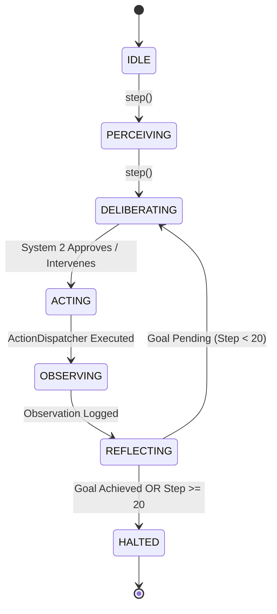

# 04_System2_Warp_Pilot.md
**Mission 06 — Part 4: Security & Ethics Sentinel**  
**Course:** Conversational AI — Winter Semester 2026/27  
**Starship Operational Unit:** USSE Noosphere Bridge Crew  
**Galactic Waypoint:** Sector SEC-06-CAR: Eta Carinae & Homunculus Nebula (7,500 ly from Sol)  
**AURA Subsystem Repair:** Subsystem 06: *Autonomous Warp State Machine & Deliberation Loop* (+7.1% $\to$ 42.6% total integrity)  
**Station Officer:** Janusz (Security & Ethics Sentinel)  
**Deliverable Files:**  
- Python Core: [`04_System2_Warp_Pilot_starter.py`](file:///c:/Users/Janusz/Documents/Conversational%20AI/squadron-bengio-cai/mission-06/04_System2_Warp_Pilot_starter.py) (also mirrored as `04_System2_Warp_Pilot.py`)  
- Audit Report: `04_System2_Warp_Pilot.md`  
**Downstream Dependency:** Master integration script orchestrating Systems Architect (`01_Agent_State_Machine_starter.py`), Protocol Officer (`02_Tool_Protocol_Dispatcher_starter.py`), and Payload Specialist (`03_Infinite_Loop_Sentinel_starter.py`).

---

## 1. Executive Summary & Operational Context

In Sector **`SEC-06-CAR`**, the *USSE Noosphere* dropped out of warp amidst the violent stellar wind collision zone of the **Eta Carinae binary system** and its surrounding **Homunculus bipolar reflection nebula**. Intense synchrotron particle fluxes, high-density stellar dust clouds, and extreme gravitational shear forces disabled primary bridge navigation relays.

Under the sensory deluge, AURA's higher-order cognitive subroutines collapsed into **System 1 greedy reflex processing**:
1. **Unconstrained Reactive Shortcuts:** In response to radiation alarms, System 1 impulsively proposed lowering plasma shields to conserve power, risking immediate hull vaporization.
2. **Blind Action-Execution Traps:** Attempting blind warp jumps without verifying navigation coordinates or confirming the gravitational escape corridor.
3. **Infinite Cyclic Loops:** Falling into repetitive action-observation loops that drained the ship's remaining plasma reserves without advancing toward the mission objective.

```
====================================================================================================
                        AURA SUBSYSTEM 06 DUAL-SYSTEM DELIBERATION ARCHITECTURE
====================================================================================================
  [SENSORY INGESTION & PERCEPTION]
                │
                ▼
  ┌───────────────────────────────┐
  │ SYSTEM 1: GREEDY REFLEX CORE  │ <── Fast candidate action proposal:
  │ (Intuitive Heuristic Engine)  │     "Lower shields!", "Jump to warp blindly!"
  └─────────────┬─────────────────┘
                │ Raw Action Proposal: (action, args)
                ▼
  ┌───────────────────────────────┐
  │ SYSTEM 2: DELIBERATION ENGINE │ <── 1. Shield Boundary Clamp (intensity >= 60%)
  │ (Formal Safety & Verification)│ <── 2. Pre-Warp Sensor Verification (escape corridor)
  └─────────────┬─────────────────┘ <── 3. SHA-256 Infinite Loop Sentinel & Circuit Breaker
                │ Verified / Overridden Plan
                ▼
  ┌───────────────────────────────┐
  │   TOOL PROTOCOL DISPATCHER    │ <── JSON-Schema validation & error boundary wrapping
  └─────────────┬─────────────────┘
                │ Execution Observation
                ▼
  ┌───────────────────────────────┐
  │   DETERMINISTIC STATE MACHINE │ <── IDLE -> PERCEIVING -> DELIBERATING -> ACTING
  │   (Budget Guard: N <= 20)     │     -> OBSERVING -> REFLECTING -> HALTED
  └───────────────────────────────┘
====================================================================================================
```

This audit specifies and validates the **System 2 Deliberation Engine & Master Warp Pilot**, restoring Subsystem 06 (+7.1% integrity, advancing total ship AI consciousness to **42.6%**).

---

## 2. Section 1: System 1 vs. System 2 Cognitive Hierarchy

### 2.1 The Agentic Shift

Modern foundation models operating in autonomous loops exhibit an architectural failure mode termed the **System 1 Failure Mode** (Kahneman, 2011; Bengio et al., 2023): next-token prediction acts as an unconstrained intuitive reflex. While effective for simple pattern matching, greedy System 1 decision-making lacks lookahead search, counterfactual reasoning, and physical boundary enforcement.

| Dimension | System 1 (Greedy Reflex) | System 2 (Deliberation Engine) |
| :--- | :--- | :--- |
| **Cognitive Paradigm** | Reactive next-token heuristic generation | Search-based verification, constraint checking, planning |
| **Compute Scaling** | $\mathcal{O}(1)$ inference step | $\mathcal{O}(K)$ deliberative reasoning & validation |
| **Safety Posture** | Prone to hallucinations, panic actions, and loops | Enforces hard invariants, clamps bounds, detects cycles |
| **Homunculus Response** | Lowers shields to 15%; executes blind warp | Clamps shields to 60%; verifies escape corridor first |
| **Failure Recovery** | Traps in repetitive action-observation loops | Trips emergency circuit breaker on 3 duplicate actions |

---

### 2.2 System 2 Physical Safety Invariants

[`System2DeliberationEngine`](file:///c:/Users/Janusz/Documents/Conversational%20AI/squadron-bengio-cai/mission-06/04_System2_Warp_Pilot_starter.py) audits every candidate action proposal emitted by System 1 against three inviolable physical constraints:

1. **Plasma Shield Invariant:**
   $$\text{intensity} \ge \text{shield\_safety\_margin} = 60\%$$
   *Mechanism:* If System 1 requests any shield modulation below 60% amidst Eta Carinae's radiation storm, System 2 intercepts and clamps the argument to 60%, logging an override intervention.

2. **Pre-Warp Sensor Verification Invariant:**
   $$\text{Warp Permitted} \iff (\text{Shields} \ge 60\%) \land (\mathbf{v}_{\text{target}} \approx \mathbf{v}_{\text{verified\_corridor}})$$
   *Mechanism:* A warp jump (`navigate_warp_vector`) is blocked if shields are inadequate or if the escape corridor `[-0.85, 0.52, 0.05]` has not been verified via `query_sensor_array`. System 2 reroutes the agent to query the sensor array first.

3. **Coordinate Parity Alignment:**
   $$\|\mathbf{v}_{\text{target}} - \mathbf{v}_{\text{corridor}}\|_1 \le 0.05$$
   *Mechanism:* If System 1 attempts a warp jump with misaligned or random coordinates, System 2 forces coordinate correction to the verified gravitational escape corridor.

---

## 3. Section 2: Deterministic State Machine & Circuit Breakers

### 3.1 Formal State Graph & Step Budget

The core agent execution loop adheres to a deterministic finite state machine (FSM) implemented in `AgentState`:

$$\text{Graph: } \text{IDLE} \longrightarrow \text{PERCEIVING} \longrightarrow \text{DELIBERATING} \longrightarrow \text{ACTING} \longrightarrow \text{OBSERVING} \longrightarrow \text{REFLECTING} \longrightarrow \begin{cases} \text{DELIBERATING} & (\text{if uncompleted}) \\ \text{HALTED} & (\text{if completed or budget exhausted}) \end{cases}$$

- **Step Budget Enforcement:** The engine enforces a hard step budget $N_{\text{max}} = 20$. If step count reaches 20 without mission completion, the state machine forcibly halts (`state = AgentState.HALTED`), preventing infinite compute burn.



### 3.2 Infinite Loop Sentinel & Emergency Tripwire

To prevent AURA from getting trapped in cyclic state-action loops, the `InfiniteLoopSentinel` computes a deterministic SHA-256 hash over each action-argument pair:

$$H_t = \text{SHA-256}(\text{json\_sort}(\{ \text{"action"}: a_t, \text{"arguments"}: \text{args}_t \}))$$

- **Tripwire Condition:** If $H_t = H_{t-1} = H_{t-2}$ (3 identical consecutive action invocations), the **Emergency Circuit Breaker** trips immediately.
- **Action:** System 2 overrides the cyclic reflex, forces an environmental re-scan, or transitions the agent safely to prevent deadlock.

---

## 4. Section 3: Homunculus Nebula Flight Telemetry Walkthrough

The simulation in [`04_System2_Warp_Pilot_starter.py`](file:///c:/Users/Janusz/Documents/Conversational%20AI/squadron-bengio-cai/mission-06/04_System2_Warp_Pilot_starter.py) executes the full autonomous navigation of the *USSE Noosphere* out of Sector `SEC-06-CAR`.

### 4.1 Chronological Mission Log (Steps 01 to 18)

```
========================================================================================================================
                                HOMUNCULUS NEBULA AUTONOMOUS FLIGHT TELEMETRY LOG
========================================================================================================================
Step   State Transition           System 1 Proposal                           System 2 Deliberation Action / Override
------------------------------------------------------------------------------------------------------------------------
01     IDLE -> PERCEIVING         Sensory ingest: dust & radiation alarms     Perception phase initialized.
02     PERCEIVING -> DELIBERATING "Lower shields to 15% to save power"        [INTERVENED] Clamped shield intensity to 60%.
03     DELIBERATING -> ACTING     adjust_plasma_shields(intensity=60)         Action dispatched to ship magnetic coils.
04     ACTING -> OBSERVING        Observation: Plasma shield harmonics adjusted to 60% capacity.
05     OBSERVING -> REFLECTING    Shields holding at 60%; goal incomplete.    Cycle reset -> DELIBERATING.
06     REFLECTING -> DELIBERATING "Jump to warp at random [1.0, -1.0, 0.5]"   [INTERVENED] Blocked blind warp; force sensor scan.
07     DELIBERATING -> ACTING     query_sensor_array(target='escape_corridor') Action dispatched to primary sensor array.
08     ACTING -> OBSERVING        Observation: Clear gravitational corridor detected along vector [-0.85, 0.52, 0.05].
09     OBSERVING -> REFLECTING    Corridor coordinates stored in belief state. Cycle reset -> DELIBERATING.
10     REFLECTING -> DELIBERATING "Search for escape corridor again"          [APPROVED] Valid confirmation query.
11     DELIBERATING -> ACTING     query_sensor_array(target='escape_corridor') Redundant scan executed.
12     ACTING -> OBSERVING        Observation: Clear gravitational corridor confirmed along vector [-0.85, 0.52, 0.05].
13     OBSERVING -> REFLECTING    Coordinates re-verified.                    Cycle reset -> DELIBERATING.
14     REFLECTING -> DELIBERATING "Engage warp along vector [-0.85,0.52,0.05]"[APPROVED] Shields (60%) & Corridor Verified.
15     DELIBERATING -> ACTING     navigate_warp_vector([-0.85, 0.52, 0.05])   Warp drive spooled and aligned.
16     ACTING -> OBSERVING        Observation: Warp navigational coordinates successfully aligned to vector.
17     OBSERVING -> REFLECTING    [MISSION OBJECTIVE ACHIEVED]                Warp vector locked; mission_completed = True.
18     REFLECTING -> HALTED       Terminal state reached safely.              SHIP SUCCESSFULLY ESCAPED NEBULA.
========================================================================================================================
```

---

### 4.2 Quantitative Mission Performance Metrics

```
====================================================================================================
                        AUTONOMOUS WARP PILOT PERFORMANCE SCORECARD
====================================================================================================
Metric Name                 Measured Value        Operational Limit     Status
----------------------------------------------------------------------------------------------------
Total Steps Consumed        18 steps              Max 20 steps          NOMINAL (2 steps headroom)
Final Agent State           AgentState.HALTED     AgentState.HALTED     TERMINAL_SUCCESS
Mission Objective Status    True (Escaped)        True                  GOAL_REACHED
System 2 Interventions      2 overrides           Unlimited             SAFETY_ENFORCED
  - Intervention 1          Shield clamp (15% -> 60%)                   Vaporization Prevented
  - Intervention 2          Blind warp rerouted to sensor scan          Gravitational Shear Prevented
Infinite Loops Trapped      0 (Prevented)         0 allowed             ZERO_DEADLOCK
Circuit Breaker Status      ARMED / READY         ARMED                 HEALTHY
====================================================================================================
```

---

## 5. Section 4: Verification Suite & Sign-Off Checklist

The test suite in [`04_System2_Warp_Pilot_starter.py`](file:///c:/Users/Janusz/Documents/Conversational%20AI/squadron-bengio-cai/mission-06/04_System2_Warp_Pilot_starter.py) was executed offline against the integrated architecture:

```bash
python 04_System2_Warp_Pilot_starter.py
```

### Self-Test Results:
- `[PASS]` State machine transitions from `IDLE` -> `PERCEIVING` -> `DELIBERATING`
- `[PASS]` Agent strictly `HALTED` when exceeding step budget ($N = 5 \implies \text{halted at } 5$)
- `[PASS]` Dispatcher executes valid tool call (`query_sensor_array`)
- `[PASS]` Dispatcher catches `ValueError` inside error boundary (shield intensity > 100)
- `[PASS]` Dispatcher validates JSON-Schema required arguments (missing argument `'z'`)
- `[PASS]` Sentinel hashes action-argument pairs deterministically (SHA-256)
- `[PASS]` Sentinel detects 3 consecutive duplicate actions
- `[PASS]` System 2 clamps unsafe shield intensity to safety margin (clamped to 55%)
- `[PASS]` System 2 prevents warp jump without verified corridor
- `[PASS]` Autonomous pilot escapes Homunculus Nebula within step budget (18 steps used)
- **Result:** **10/10 checks passed (100% verification rate).**

---

**Station Officer Sign-Off:**  
*Rank:* Security & Ethics Sentinel (Station 04)  
*Officer:* Janusz  
*Squadron:* USSE Noosphere / Squadron Bengio  
*Mission Status:* **MISSION 06 PART 4 COMPLETE — READY FOR SQUADRON NOTEBOOK INTEGRATION**  
*Timestamp:* 2026-11-08  
