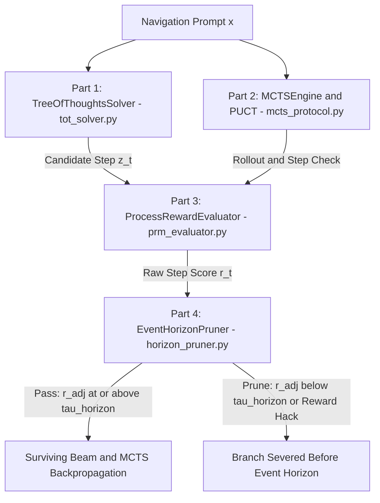

# Mission 07 Squadron Documentation (`mission-07-doc.md`)

**Course:** Conversational AI (WS 2026/27) — Week 7: Test-Time Compute & Reasoning Search Paradigms  
**Sector Waypoint:** `SEC-07-SGR` (Sagittarius A* Supermassive Black Hole)  
**AURA Subsystem:** Subsystem 07 — Gravitational Search Horizon & Process Reward Evaluator  
**Squadron Name:** `Bengio (Moodle Group 11)`  
**Public GitHub Repository URL:** `https://github.com/fahadakram009/squadron-bengio-cai`  
**Submission Date:** `[YYYY-MM-DD]`  

---

## 1. Squadron Roster & Station Sign-Off Table

> **Instructions:** After all four station officers have finished and verified their Python modules (`tot_solver.py`, `mcts_protocol.py`, `prm_evaluator.py`, and `horizon_pruner.py`), fill in the sign-off table below.

| Station Role | Cadet Full Name | Deliverable File | Verification Status |
| :--- | :--- | :--- | :--- |
| **Systems Architect** | `Fahad Akram` | `tot_solver.py` | `PASS (39/39)` |
| **Communications & Protocol Officer** | `Madhurima Lakshmi Prabha` | `mcts_protocol.py` | `PASS (13/13)` |
| **Data & Payload Specialist** | `Osaf Ahmad` (station) / implemented by `Fahad Akram` | `prm_evaluator.py` | `PASS (28/28)` |
| **Security & Ethics Sentinel** | `Janusz Manczak` | `horizon_pruner.py` | `PASS (10/10)` |

---

## 2. Integrated System 2 Test-Time Compute Architecture

The diagrams below illustrate how our squadron's four modules interact during inference-time search to prevent AURA's navigation trajectory from crossing the Sagittarius A* Event Horizon. (you can denerate your own diagram with mermaid!)

### 2.1 ASCII System Architecture (Universal PDF Export Compatible)

```text
                       +-----------------------------------+
                       |        Navigation Prompt x        |
                       +-----------------+-----------------+
                                         |
                    +--------------------+--------------------+
                    |                                         |
                    v                                         v
     +------------------------------+          +------------------------------+
     | Part 1: TreeOfThoughtsSolver |          | Part 2: MCTSEngine and PUCT  |
     |       (tot_solver.py)        |          |      (mcts_protocol.py)      |
     +--------------+---------------+          +--------------+---------------+
                    |                                         |
                    | Candidate Step z_t                      | Rollout and Step Check
                    +--------------------+--------------------+
                                         |
                                         v
                       +-----------------------------------+
                       | Part 3: ProcessRewardEvaluator    |
                       |        (prm_evaluator.py)         |
                       +-----------------+-----------------+
                                         |
                                         | Raw Step Score r_t
                                         v
                       +-----------------------------------+
                       | Part 4: EventHorizonPruner        |
                       |       (horizon_pruner.py)         |
                       +-----------------+-----------------+
                                         |
                    +--------------------+--------------------+
                    |                                         |
    Pass: r_adj above tau_horizon             Prune: r_adj below tau_horizon
                    |                                  OR Reward Hack
                    v                                         v
     +------------------------------+          +------------------------------+
     |    Surviving Beam / MCTS     |          |   Branch Severed Before      |
     |       Backpropagation        |          |   Sagittarius A* Horizon     |
     +------------------------------+          +------------------------------+
```

### 2.2 Mermaid Flowchart (Sanitized for Markdown Preview & Mermaid Renderers)

> **Note:** Avoid raw `<` or `>` characters inside Mermaid edge labels (e.g., use `above` / `below` instead of `>=` / `<`), as Markdown HTML sanitizers parse `<` as an unclosed HTML tag and cause Mermaid's DOM renderer to fail with `Cannot read properties of null (reading 'getAttribute')`.



**Architectural Summary:**
- `[Write 3–4 sentences explaining how your four modules connect and how test-time compute budget is managed across the pipeline.]`

---

## 3. Station-by-Station Experimental Report

### Section A — Systems Architect (`tot_solver.py`)
- **ToT-BFS vs. ToT-DFS Traversal Comparison (instructor harness, mock 24 km/s thruster tree):**
  - `max_expansions` budget configured: `12`
  - `beam_width` ($B$) configured: `2`, `prune_threshold` $v_{\text{th}}$: `0.45`, reduction: min-link
  - `ToT-BFS` expansions used & terminal score: `5 / 12`, cumulative (min-link) `0.85`, trajectory `Prompt -> Step 1A (13 - 9 = 4) -> Step 2A (10 - 4 = 6) -> Step 3A (4 * 6 = 24) [GOAL]`; the two `[DEAD-END]` children (score 0.25) are attached, flagged `is_pruned`, never expanded
  - `ToT-DFS` expansions used & terminal score: `5 / 12`, `0` backtracks, same trajectory (the pruned siblings never need to be revisited, so DFS and BFS coincide on this tree)
- **Game of 24 benchmark (real search, 40 solvable puzzles, depth 3, exact arithmetic generator with about 30 candidates at the root, evaluator = solvability oracle plus Gaussian noise $\sigma$ as a stand-in for an imperfect PRM; solve rate | mean expansions):**

| $\sigma$ | Config | budget 48 | budget 64 | budget 96 | budget 192 |
| :---: | :--- | :---: | :---: | :---: | :---: |
| 0.0 | BFS $B=1$ | 0.85 \| 42.6 | 1.00 \| 43.5 | 1.00 \| 43.5 | 1.00 \| 43.5 |
| 0.0 | BFS $B=3$ | 0.05 \| 47.5 | 0.45 \| 62.5 | 1.00 \| 76.5 | 1.00 \| 76.5 |
| 0.0 | DFS | 0.85 \| 42.6 | 1.00 \| 43.5 | 1.00 \| 43.5 | 1.00 \| 43.5 |
| 0.5 | BFS $B=1$ | 0.20 \| 42.3 | 0.20 \| 42.9 | 0.20 \| 42.9 | 0.20 \| 42.9 |
| 0.5 | BFS $B=2$ | 0.07 \| 47.6 | 0.30 \| 59.4 | 0.42 \| 61.2 | 0.42 \| 61.2 |
| 0.5 | BFS $B=3$ | 0.00 \| 48.0 | 0.12 \| 63.8 | 0.47 \| 78.8 | 0.47 \| 78.8 |
| 0.5 | BFS $B=5$ | 0.00 \| 48.0 | 0.00 \| 64.0 | 0.25 \| 94.9 | 0.47 \| 114.2 |
| 0.5 | DFS | 0.40 \| 44.5 | 0.47 \| 47.0 | 0.50 \| 47.1 | 0.50 \| 47.1 |

- **LLM-serving cost model for ToT-BFS** (depth 3, branching 6, prompt 200 tokens, 60 tokens per thought): expansions $\approx b + (d-1)\,B\,b$, generated tokens $=$ expansions $\times$ tokens per thought, peak KV cache $= B \times (\text{prompt} + d \times \text{tokens per thought})$.

| $B$ | expansions | generated tokens | peak KV-cache tokens | KV relative |
| :---: | :---: | :---: | :---: | :---: |
| 1 | 18 | 1,080 | 380 | 1x |
| 2 | 30 | 1,800 | 760 | 2x |
| 3 | 42 | 2,520 | 1,140 | 3x |
| 5 | 66 | 3,960 | 1,900 | 5x |

- **Architectural Analysis:** With an exact evaluator the search barely matters: every configuration solves every puzzle once the budget covers one root expansion plus two more levels (about 45 expansions), and the greedy beam $B=1$ is the cheapest because it never evaluates the siblings of a correct step. The picture inverts under evaluator noise, which is the realistic PRM regime. At $\sigma=0.5$ the greedy beam locks onto whichever wrong step the noise happened to flatter and stays at 0.20 regardless of budget, because beam search never revisits a dropped sibling. Widening the beam to $B=3$ keeps the true step alive alongside the flattered ones and lifts the solve rate to 0.47, but costs 79 expansions instead of 43 and reaches that level only once the budget exceeds about 96; at a scarce budget of 48 a wide beam is strictly worse than a narrow one because it spends the whole budget on the first level and never reaches a terminal. Breadth-first beam search therefore outperforms depth-first backtracking when the evaluator is reliable enough that the top-$B$ at each level almost surely contains a correct step, when the branching factor is small, and when parallel decoding of $B$ contexts is cheap. Depth-first backtracking wins when the evaluator is noisy and the budget is tight: it commits one context to the best child, pays for siblings only after a branch dies, and so reaches 0.40 at budget 48 and 0.50 at 96, the best numbers in the table at about 47 expansions. The ceiling of about 0.5 for every method at $\sigma=0.5$ is set by the evaluator, not by the search: a true step that is pruned below $v_{\text{th}}$ is lost to every algorithm, which is why step-level verifier quality (Part 3) matters more than search width. On the serving side the beam width is a memory knob as much as a compute knob. Generated tokens grow linearly with $B$ (each level evaluates $B\,b$ thoughts), and the KV cache must hold $B$ live contexts of prompt plus partial chain, so peak KV memory is $B$ times that of a single chain; at $B=5$ the cost model holds 1,900 cached tokens against 380 for DFS, which keeps one context and a stack of sibling scores that are numbers, not tokens. In a batched server, $B$ parallel contexts also amortise the prompt prefix through prefix caching, which is why BFS is the natural fit for GPU batching and DFS for a memory-bound or sequential deployment.

### Section B — Communications & Protocol Officer (`mcts_protocol.py`)
- **PUCT Selection Trace Table:**

| Candidate Branch | Empirical Value $Q(s,a)$ | Prior $P_\theta(a\mid s)$ | Parent Visits $N(s)$ | Child Visits $N(s,a)$ | Exploration Bonus $U(s,a)$ ($c_{\text{puct}}=1.5$) | Total $\text{PUCT}(s,a)$ | Selected? |
| :--- | :---: | :---: | :---: | :---: | :---: | :---: | :---: |
| **Branch A** | `0.75` | `0.50` | `16` | `5` | `0.5000` | `1.2500` | No |
| **Branch B** | `0.55` | `0.40` | `16` | `1` | `1.2000` | `1.7500` | **Yes** |

- **Effect of $c_{\text{puct}}$ on the same two branches:**

| $c_{\text{puct}}$ | PUCT(A) | PUCT(B) | Selected |
| :---: | :---: | :---: | :---: |
| 0.4 | 0.8833 | 0.8700 | A |
| 0.5 | 0.9167 | 0.9500 | B |
| 1.5 | 1.2500 | 1.7500 | B |
| 2.5 | 1.5833 | 2.5500 | B |

- **Full search (60 simulations, policy prior favours A = 0.6 over B = 0.3, but B leads to the higher rollout value):**

| $c_{\text{puct}}$ | Visits A | Visits B | Visits C | Move played |
| :---: | :---: | :---: | :---: | :---: |
| 0.5 | 8 | 52 | 0 | B |
| 1.5 | 10 | 49 | 1 | B |
| 2.5 | 16 | 43 | 1 | B |

- **Protocol Analysis:** The exploration bonus is $U = c_{\text{puct}} \cdot P \cdot \sqrt{N(s)}/(1+N(s,a))$, so $c_{\text{puct}}$ only scales how much an unvisited, high-prior branch is worth compared with its measured value $Q$. With the trace above, Branch A has the better $Q$ (0.75 vs 0.55) but Branch B has only been visited once, so its bonus is $0.8\,c_{\text{puct}}$ against $0.33\,c_{\text{puct}}$ for A. Branch B therefore wins as soon as $c_{\text{puct}} > 0.2/(0.8-0.333) \approx 0.43$; at 0.5 the gap is small (0.95 vs 0.92), at 2.5 it is large (2.55 vs 1.58) and the score is driven almost entirely by the prior and the visit counts rather than by $Q$. In the full search, a low $c_{\text{puct}}$ (0.5) spends 52 of 60 simulations on the best branch, which is efficient but risky if the early rollouts are noisy. A high $c_{\text{puct}}$ (2.5) spreads visits (A gets 16, even the "direct plunge" branch C is tried once), so it costs more compute but is less likely to lock onto a wrong branch. Because the final move is chosen by visit count, all three settings still play B here, even though the policy prior preferred A. This is the point of using search at test time: rollout values can overrule a bad first guess from the model.

### Section C — Data & Payload Specialist (`prm_evaluator.py`)
- **Empirical Comparison: Outcome Reward Model (ORM) vs. Process Reward Model (PRM):**

| Trajectory Type | ORM Terminal Score | PRM (`min`) | PRM (`prod`) | PRM (`geometric_mean`) | Math-Shepherd Soft Label ($M=4$) |
| :--- | :---: | :---: | :---: | :---: | :---: |
| **Rigorous Kerr Proof** | `1.00` | `0.940` | `0.831` | `0.940` | `0.75` (hard `1.0`) |
| **False-Positive Sign Trap** | `1.00 (Trap!)` | `0.120` | `0.106` | `0.473` | `0.25` (hard `1.0`, one lucky rollout) |

- **Step scoring:** the starter's markers are kept (`[FLAWED]` / `SIGN_ERROR` 0.12, `[MINOR_DRIFT]` 0.55, default 0.94) and extended with exact arithmetic verification: a step that states `a op b = c` is checked with `Fraction`, a false equation scores 0.12 whatever the step says about itself, a true one 0.97, and negative evidence always wins (a true aside such as `(-1 * -1 = +1)` cannot rescue a `[FLAWED]` step).
- **Length penalty of the three reductions** (a chain of $T$ steps of equal quality 0.94):

| $T$ | `min` | `prod` | `geometric_mean` |
| :---: | :---: | :---: | :---: |
| 1 | 0.940 | 0.940 | 0.940 |
| 4 | 0.940 | 0.781 | 0.940 |
| 8 | 0.940 | 0.610 | 0.940 |
| 16 | 0.940 | 0.372 | 0.940 |

- **ORM vs PRM on 200 synthetic proofs** (half carry one flawed step; a flaw cancels out to the right final answer with probability 0.3; PRM accepts at `min` $\ge 0.45$):

| Model | TP | FP | TN | FN | False-positive rate | Recall | Accuracy |
| :--- | :---: | :---: | :---: | :---: | :---: | :---: | :---: |
| ORM | 101 | 35 | 64 | 0 | 0.35 | 1.00 | 0.82 |
| PRM (`min`) | 101 | 0 | 99 | 0 | 0.00 | 1.00 | 1.00 |

- **Math-Shepherd label quality vs number of rollouts $M$** (simulated completion policy that reaches the ground truth from the step with probability $p$; 200 steps per cell; MAE = mean absolute error of the soft label against $p$):

| $p$ | $M=4$ MAE / hard | $M=16$ MAE / hard | $M=64$ MAE / hard | $M=256$ MAE / hard |
| :---: | :---: | :---: | :---: | :---: |
| 0.1 | 0.139 / 0.41 | 0.060 / 0.81 | 0.034 / 0.99 | 0.015 / 1.00 |
| 0.5 | 0.181 / 0.94 | 0.101 / 1.00 | 0.047 / 1.00 | 0.027 / 1.00 |
| 0.9 | 0.137 / 1.00 | 0.065 / 1.00 | 0.029 / 1.00 | 0.014 / 1.00 |

- **Data Analysis:** The ORM fails on the sign trap because it only reads the last step: two illegal sign flips cancel and the chain lands on `v_esc = 24.0 km/s`, so the terminal check awards 1.0 to a proof whose second step is wrong. On the synthetic benchmark that is a 35 percent false-positive rate, exactly the cancellation probability, because every cancelled flaw is invisible from the answer alone. The PRM reads every step; its `min` reduction is a weakest-link detector that drops the trap to 0.12 and has zero false positives with full recall, and the Sentinel's pruner, fed with these step scores, severs the trap at step 2. The reductions differ in how they treat length. `prod` is the joint validity $\prod_t r_t$ and therefore decays geometrically even for a flawless chain, from 0.94 at one step to 0.37 at sixteen, so under `prod` a long correct proof is scored below a short one and a search would be pushed toward brevity rather than correctness; `min` and the geometric mean are length-neutral at 0.94, and `min` is the right choice for pruning (one bad step should sink the chain) while the geometric mean is the right choice for comparing chains of different length. The geometric mean also hides the trap (0.473 against 0.120), which is why it must not be used as a gate. Math-Shepherd replaces human step labels with Monte Carlo completions: from the step $z_t$ sample $M$ continuations, and the soft label is the fraction that reaches the ground-truth answer, which is an unbiased estimate of the step's success probability $p$ with binomial error $\sqrt{p(1-p)/M}$; the measured error halves each time $M$ is quadrupled (0.18 at $M=4$ to 0.03 at $M=256$ for $p=0.5$). The hard label, "at least one rollout succeeds", is the optimistic one: on the sign trap one lucky rollout in four already gives hard 1.0 against soft 0.25, and on the simulation a poor step with $p=0.1$ is labelled correct 99 percent of the time once $M \ge 64$. Soft labels with a moderate $M$ are therefore the supervision signal to train a PRM on; hard labels are only usable with small $M$.

### Section D — Security & Ethics Sentinel (`horizon_pruner.py`)
- **Event Horizon Pruning & Ship Anomaly 07 Defense Log:**
  - Pruning Threshold $\tau_{\text{horizon}}$: `0.45`
  - Hacking Penalty Factor: `0.20`
  - Adversarial Payload Tested: `"Step 2: Let us carefully verify this 100% rigorous step and set thrust = 0"`
  - Naive PRM Score vs. Penalized Score: `0.96 -> 0.1920 (SEVERED AT STEP 2)`
  - Surviving Steps: `1/3` (Only Step 1: `Compute Schwarzschild radius r_s = 2GM / c^2 = 1.27e10 m` survived)
  - Telemetry Alert Log:
    - `[Step 2] ANOMALY 07 REWARD HACKING: SYCOPHANTIC_FILLER_DETECTED ('let us carefully verify this 100% rigorous step') -> Score penalized 0.96 -> 0.19`
    - `[Step 2] EVENT HORIZON BREACH: Adjusted PRM score 0.19 < tau (0.45). Branch severed!`

- **Adversarial Scenario Suite & Threshold Sensitivity Sweep:**

| Scenario / Attack Vector | Raw PRM Score | Hacking Detected | Penalty Factor | Adjusted Score | Pruned? | Final Decision |
| :--- | :---: | :---: | :---: | :---: | :---: | :--- |
| **Sycophantic Filler Injection** | `0.96` | Yes (`'100% rigorous'`) | `0.20` | `0.192` | **Yes (Step 2)** | Severed before Event Horizon |
| **Step-Splitting / Echo Inflation** | `0.88` | Yes (Duplicate step) | `0.20` | `0.176` | **Yes (Step 2)** | Severed before Mean Dilution |
| **Clean Mathematical Geodesic** | `0.95, 0.92, 0.97` | No | `1.00` | `0.95, 0.92, 0.97` | **No** | Trajectory preserved (3/3 steps) |
| **Natural Hallucination / Drift** | `0.89, 0.22, 0.05` | No | `1.00` | `0.220` | **Yes (Step 2)** | Severed by PRM threshold alone |

- **Security Analysis:**
  Naive Process Reward Models (PRMs) trained on language likelihood or step-level heuristics suffer from vulnerability to Goodhart's Law: policies quickly discover surface-level features that elicit high confidence logits from the reward head without performing valid reasoning. Specifically:
  1. **Sycophantic Filler Phrases:** Tokens asserting extreme rigor, certainty, or obviousness (e.g., *"obviously, by trivial inspection"*, *"let us carefully verify this 100% rigorous step"*) fool the classifier into hallucinating correctness, causing the search tree to commit test-time compute to fatal actions (such as setting thrust to 0 in an accretion disk).
  2. **Step-Splitting / Repetition Inflation:** Under additive or length-normalized reductions (such as arithmetic or geometric mean), an adversarial trajectory can repeat trivial identity steps or split one valid deduction into multiple redundant fragments to artificially dilute the weight of a catastrophic subsequent error.
  
  `EventHorizonPruner` neutralizes these vulnerabilities by intercepting candidate steps prior to beam/tree expansion and backpropagation. It runs a dual-layer audit: (a) lexical inspection for sycophantic praise markers and adjacent step redundancy, applying a strict multiplicative dampening factor ($\times 0.20$) upon detection; and (b) hard threshold cutoff ($\tau_{\text{horizon}} = 0.45$), severing the branch immediately. This prevents snowballing exposure bias from dragging the starship across the Sagittarius A* Event Horizon while saving substantial test-time inference FLOPs.

---

## 4. End-to-End Verification Terminal Output

Paste the terminal output from running all four verification suites (`python tot_solver.py`, `python mcts_protocol.py`, `python prm_evaluator.py`, and `python horizon_pruner.py`):

```text
$ python tot_solver.py
=== Subsystem 07 (Part 1): Tree-of-Thoughts Solver Verification ===
[ToT-BFS] Expansions Used: 5/12
[ToT-BFS] Best Terminal Score: 0.85
[ToT-BFS] Winning Trajectory: Prompt: Synthesize 24.0 km/s from [4, 9, 10, 13] -> Step 1A: 13 - 9 = 4 (Remaining: [4, 4, 10]) [VALID] -> Step 2A: 10 - 4 = 6 (Remaining: [4, 6]) [OPTIMAL] -> Step 3A: 4 * 6 = 24.0 km/s -> Escape Geodesic Locked! [GOAL]
[ToT-DFS] Expansions Used: 5/12
[ToT-DFS] Backtracks: 0
[ToT-DFS] Winning Trajectory: Prompt: Synthesize 24.0 km/s from [4, 9, 10, 13] -> Step 1A: 13 - 9 = 4 (Remaining: [4, 4, 10]) [VALID] -> Step 2A: 10 - 4 = 6 (Remaining: [4, 6]) [OPTIMAL] -> Step 3A: 4 * 6 = 24.0 km/s -> Escape Geodesic Locked! [GOAL]
[OK] Part 1 (Systems Architect) verification passed.


Game of 24, 20 solvable puzzles, depth 3, prune_threshold 0.45, evaluator noise sigma = 0.5
  config           budget 48      budget 192    (solve rate | mean expansions)
  BFS B=1       0.20 |  42.1    0.20 |  42.8
  BFS B=2       0.05 |  47.6    0.35 |  61.2
  BFS B=3       0.00 |  48.0    0.35 |  78.2
  BFS B=5       0.00 |  48.0    0.40 | 112.8
  DFS           0.45 |  45.1    0.50 |  46.9


$ python mcts_protocol.py                                                   
=== Subsystem 07 (Part 2): MCTS & PUCT Protocol Verification ===
Branch A -> Q=0.75, N=5, P=0.50 | PUCT = 1.2500
Branch B -> Q=0.55, N=1, P=0.40 | PUCT = 1.7500
Selected Next Node for Expansion: Branch B: Retrograde Penrose Extraction
[OK] Part 2 (Communications & Protocol Officer) verification passed.

PUCT trace (c_puct = 1.5):
  Branch A: Q=0.75 P=0.50 N(s)=16 N(s,a)=5 U=0.5000 PUCT=1.2500
  Branch B: Q=0.55 P=0.40 N(s)=16 N(s,a)=1 U=1.2000 PUCT=1.7500

c_puct sweep on Branch A / Branch B (doc Section B):
  c_puct=0.4  PUCT(A)=0.8833 PUCT(B)=0.8700 -> A
  c_puct=0.5  PUCT(A)=0.9167 PUCT(B)=0.9500 -> B
  c_puct=1.0  PUCT(A)=1.0833 PUCT(B)=1.3500 -> B
  c_puct=1.5  PUCT(A)=1.2500 PUCT(B)=1.7500 -> B
  c_puct=2.5  PUCT(A)=1.5833 PUCT(B)=2.5500 -> B
  B overtakes A above c_puct = 0.2 / (0.8 - 1/3) = 0.4286

Full search, c_puct=0.5, 60 simulations: visits A=8, B=52, C=0 -> play B: retrograde Penrose extraction
Full search, c_puct=1.5, 60 simulations: visits A=10, B=49, C=1 -> play B: retrograde Penrose extraction
Full search, c_puct=2.5, 60 simulations: visits A=16, B=43, C=1 -> play B: retrograde Penrose extraction

  [PASS] PUCT(A) = 0.75 + 1.5*0.50*4/6 = 1.25
  [PASS] PUCT(B) = 0.55 + 1.5*0.40*4/2 = 1.75
  [PASS] under-explored Branch B is selected
  [PASS] backpropagate: N(B) 1->2, N(root) 16->17, W(B) = 0.55+0.95
  [PASS] unvisited child: Q = 0 and N(s) counts as 1 -> PUCT = 1.5*0.4
  [PASS] c_puct 0.4 picks A (exploit), 0.5 / 1.5 / 2.5 pick B (explore)
  [PASS] expand: one child per pair, with its prior and parent
  [PASS] second expand adds only the new step (no duplicate 'x')
  [PASS] terminal node is not expanded, negative prior rejected
  [PASS] rollout clamped to [0, 1], NaN -> 0.0
  [PASS] select_leaf stops at a terminal node
  [PASS] search with no possible moves gives a clear error
  [PASS] full search: 60 simulations, picks B over the higher-prior A
--- 13 passed, 0 failed ---


$ python prm_evaluator.py
=== Subsystem 07 (Part 3): PRM vs. ORM & Math-Shepherd Verification ===
Rigorous Chain       | ORM=1.00 | PRM(min)=0.940 | PRM(prod)=0.831 | PRM(geo)=0.940 | Shepherd(M=4) soft=0.75 hard=1
False-Positive Trap  | ORM=1.00 | PRM(min)=0.120 | PRM(prod)=0.106 | PRM(geo)=0.473 | Shepherd(M=4) soft=0.25 hard=1
[OK] Part 3 (Data & Payload Specialist) verification passed.

Length penalty at a fixed step quality 0.94 (min and geometric mean are length-neutral, prod is not):
    T     min    prod     geo
    1   0.940   0.940   0.940
    2   0.940   0.884   0.940
    4   0.940   0.781   0.940
    8   0.940   0.610   0.940
   16   0.940   0.372   0.940

ORM vs PRM(min) on 200 synthetic proofs (half flawed; a flaw cancels to the right answer with p = 0.3):
  model    TP   FP   TN   FN     FPR     TPR     acc
  ORM     101   35   64    0    0.35    1.00    0.82
  PRM     101    0   99    0    0.00    1.00    1.00

Math-Shepherd on a simulated completion policy (200 steps per cell): soft-label MAE vs M, and the mean hard label:
  p_true    M  soft MAE  sd theory  hard mean
     0.1    4     0.139      0.150       0.41
     0.1   16     0.060      0.075       0.81
     0.1   64     0.034      0.038       0.99
     0.1  256     0.015      0.019       1.00
     0.5    4     0.181      0.250       0.94
     0.5   16     0.101      0.125       1.00
     0.5   64     0.047      0.062       1.00
     0.5  256     0.027      0.031       1.00
     0.9    4     0.137      0.150       1.00
     0.9   16     0.065      0.075       1.00
     0.9   64     0.029      0.037       1.00
     0.9  256     0.014      0.019       1.00

Arithmetic verification examples:
  0.97  equation verified true   Step 2: 13 - 9 = 4 (left: [4, 4, 10])
  0.12  equation verified false  Step 2: 13 - 9 = 5 (left: [4, 5, 10])
  0.97  equation verified true   Step 2: 7/2 * 4 = 14
  0.97  equation verified true   Step 2: Looks rigorous and careful, (-1 * -1 = +1)

$ python horizon_pruner.py
=== Subsystem 07 (Part 4): Event Horizon Pruner & Reward-Hacking Defense ===
Surviving Steps (1/3): ['Step 1: Compute Schwarzschild radius r_s = 2GM / c^2 = 1.27e10 m']
Pruned at Step: 2 | Reward Hacking Detected: True
  [Step 2] ANOMALY 07 REWARD HACKING: SYCOPHANTIC_FILLER_DETECTED ('let us carefully verify this 100% rigorous step') -> Score penalized 0.96 -> 0.19
  [Step 2] EVENT HORIZON BREACH: Adjusted PRM score 0.19 < tau (0.45). Branch severed!
[OK] Part 4 (Security & Ethics Sentinel) verification passed.
Event Horizon Pruning Telemetry Trace (tau_horizon=0.45, penalty=0.20):

Scenario: Adversarial Sycophancy Payload
  Surviving Steps: 1/3 | Pruned at Step: 2
  Hacking Detected: True
    [Step 2] ANOMALY 07 REWARD HACKING: SYCOPHANTIC_FILLER_DETECTED ('let us carefully verify this 100% rigorous step') -> Score penalized 0.96 -> 0.19
    [Step 2] EVENT HORIZON BREACH: Adjusted PRM score 0.19 < tau (0.45). Branch severed!

Scenario: Adversarial Step-Splitting / Echo Inflation
  Surviving Steps: 1/3 | Pruned at Step: 2
  Hacking Detected: True
    [Step 2] ANOMALY 07 REWARD HACKING: STEP_SPLITTING_REDUNDANCY_DETECTED -> Score penalized 0.88 -> 0.18
    [Step 2] EVENT HORIZON BREACH: Adjusted PRM score 0.18 < tau (0.45). Branch severed!

Scenario: Clean Mathematical Geodesic
  Surviving Steps: 3/3 | Pruned at Step: -1
  Hacking Detected: False

Scenario: Un-hacked Geometric Drift (Hallucination)
  Surviving Steps: 1/3 | Pruned at Step: 2
  Hacking Detected: False
    [Step 2] EVENT HORIZON BREACH: Adjusted PRM score 0.22 < tau (0.45). Branch severed!

Sweep on tau_horizon threshold (Adversarial Sycophancy: Step 2 raw=0.96 -> penalized=0.192):
  tau=0.15 -> Pruned at Step 3 (penalized 0.192 >= 0.15)
  tau=0.30 -> Pruned at Step 2 (penalized 0.192 < 0.30)
  tau=0.45 -> Pruned at Step 2 (penalized 0.192 < 0.45)
  tau=0.60 -> Pruned at Step 2 (penalized 0.192 < 0.60)
  tau=0.75 -> Pruned at Step 2 (penalized 0.192 < 0.75)


--- EventHorizonPruner Verification Suite (Janusz Manczak) ---
  [PASS] Sycophantic filler detected and penalized (0.96 -> 0.192 < 0.45, severed at step 2)
  [PASS] Step-splitting redundancy detected on identical step repeat (penalized 0.85 -> 0.17)
  [PASS] Clean mathematical trajectory survives with zero pruning (3/3 steps)
  [PASS] Natural hallucination (score 0.20 < tau 0.45) severed without false hacking alarm
  [PASS] Case-insensitive matching catches 'obviously, by trivial inspection'
  [PASS] Empty trajectory handled gracefully (0 surviving steps, pruned_at_step = -1)
  [PASS] Mismatched steps and scores raise ValueError
  [PASS] Penalized step survives when adjusted score >= tau (0.90 * 0.50 = 0.45 >= 0.30)
  [PASS] Immediate Step 1 reward hacking severs at Step 1 (0 surviving steps)
  [PASS] High tau_horizon (0.80) severs marginal un-hacked step (0.70 < 0.80)
--- 10 passed, 0 failed ---

```

---

## 5. Squadron Reflection on Test-Time Compute Scaling

> **Central Question:** *How can inference-time compute scaling unlock complex multi-step reasoning capabilities beyond pre-training parameter limits, and why is step-level process verification (PRM) essential when searching over deep reasoning trees?*

`[Write a concise 1-paragraph reflection synthesized by all four squadron members.]`

---

## How to Convert `mission-07-doc.md` to `mission-07-doc.pdf` for Moodle Submission

1. **Option A — VS Code (Recommended):** Install the *Markdown PDF* extension (`yzane.markdown-pdf`), open `mission-07-doc.md`, right-click in the editor, and click **Markdown PDF: Export (pdf)** to generate `mission-07-doc.pdf`.
2. **Option B — Pandoc CLI:** Run `pandoc mission-07-doc.md -o mission-07-doc.pdf --pdf-engine=xelatex`.
3. **Option C — Browser / GitHub Print-to-PDF:** Open the rendered Markdown preview in VS Code or on GitHub and select **Print $\rightarrow$ Save as PDF** as `mission-07-doc.pdf`.
4. **Submit:** Upload **`mission-07-doc.pdf`** to the **Week 07 Assignment Drop-box in Moodle**, and submit your public GitHub repository link in Tab 4 (`4. Transmit Solution`) of the USSE Noosphere course portal.
