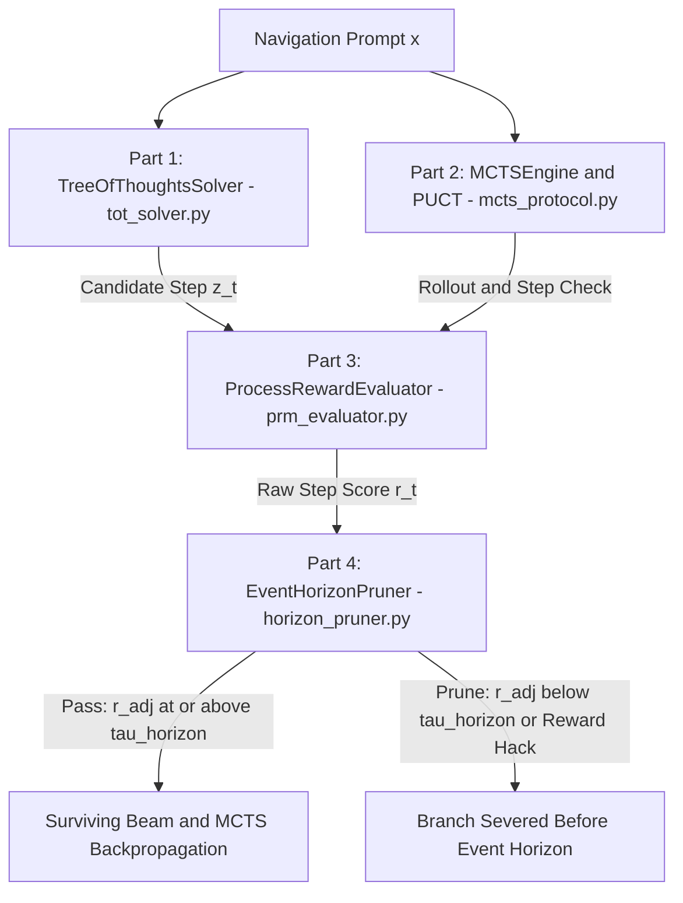

# Mission 07 Squadron Documentation (`mission-07-doc.md`)

**Course:** Conversational AI (WS 2026/27) — Week 7: Test-Time Compute & Reasoning Search Paradigms  
**Sector Waypoint:** `SEC-07-SGR` (Sagittarius A* Supermassive Black Hole)  
**AURA Subsystem:** Subsystem 07 — Gravitational Search Horizon & Process Reward Evaluator  
**Squadron Name:** `Bengio (Moodle Group 11)`  
**Public GitHub Repository URL:** `https://github.com/fahadakram009/squadron-bengio-cai`  
**Submission Date:** `[YYYY-MM-DD]`  

---

## 1. Squadron Roster & Station Sign-Off Table

> **Instructions:** After all four station officers have finished and verified their Python modules (`tot_solver.py`, `mcts_protocol.py`, `prm_evaluator.py`, and `horizon_pruner.py`), fill in the sign-off table below.

| Station Role | Cadet Full Name | Deliverable File | Verification Status |
| :--- | :--- | :--- | :--- |
| **Systems Architect** | `[Insert Name]` | `tot_solver.py` | `[PASS / VERIFIED]` |
| **Communications & Protocol Officer** | `Madhurima Lakshmi Prabha` | `mcts_protocol.py` | `PASS (13/13)` |
| **Data & Payload Specialist** | `[Insert Name]` | `prm_evaluator.py` | `[PASS / VERIFIED]` |
| **Security & Ethics Sentinel** | `Janusz Manczak` | `horizon_pruner.py` | `PASS (10/10)` |

---

## 2. Integrated System 2 Test-Time Compute Architecture

The diagrams below illustrate how our squadron's four modules interact during inference-time search to prevent AURA's navigation trajectory from crossing the Sagittarius A* Event Horizon. (you can denerate your own diagram with mermaid!)

### 2.1 ASCII System Architecture (Universal PDF Export Compatible)

```text
                       +-----------------------------------+
                       |        Navigation Prompt x        |
                       +-----------------+-----------------+
                                         |
                    +--------------------+--------------------+
                    |                                         |
                    v                                         v
     +------------------------------+          +------------------------------+
     | Part 1: TreeOfThoughtsSolver |          | Part 2: MCTSEngine and PUCT  |
     |       (tot_solver.py)        |          |      (mcts_protocol.py)      |
     +--------------+---------------+          +--------------+---------------+
                    |                                         |
                    | Candidate Step z_t                      | Rollout and Step Check
                    +--------------------+--------------------+
                                         |
                                         v
                       +-----------------------------------+
                       | Part 3: ProcessRewardEvaluator    |
                       |        (prm_evaluator.py)         |
                       +-----------------+-----------------+
                                         |
                                         | Raw Step Score r_t
                                         v
                       +-----------------------------------+
                       | Part 4: EventHorizonPruner        |
                       |       (horizon_pruner.py)         |
                       +-----------------+-----------------+
                                         |
                    +--------------------+--------------------+
                    |                                         |
    Pass: r_adj above tau_horizon             Prune: r_adj below tau_horizon
                    |                                  OR Reward Hack
                    v                                         v
     +------------------------------+          +------------------------------+
     |    Surviving Beam / MCTS     |          |   Branch Severed Before      |
     |       Backpropagation        |          |   Sagittarius A* Horizon     |
     +------------------------------+          +------------------------------+
```

### 2.2 Mermaid Flowchart (Sanitized for Markdown Preview & Mermaid Renderers)

> **Note:** Avoid raw `<` or `>` characters inside Mermaid edge labels (e.g., use `above` / `below` instead of `>=` / `<`), as Markdown HTML sanitizers parse `<` as an unclosed HTML tag and cause Mermaid's DOM renderer to fail with `Cannot read properties of null (reading 'getAttribute')`.



**Architectural Summary:**
- `[Write 3–4 sentences explaining how your four modules connect and how test-time compute budget is managed across the pipeline.]`

---

## 3. Station-by-Station Experimental Report

### Section A — Systems Architect (`tot_solver.py`)
- **ToT-BFS vs. ToT-DFS Traversal Comparison:**
  - `max_expansions` budget configured: `[e.g., 12]`
  - `beam_width` ($B$) configured: `[e.g., 2]`
  - `ToT-BFS` expansions used & terminal score: `[Insert results]`
  - `ToT-DFS` expansions used & terminal score: `[Insert results]`
- **Architectural Analysis:** `[Explain when Breadth-First Beam Search outperforms Depth-First Backtracking and how beam width B affects KV-cache memory and token cost.]`

### Section B — Communications & Protocol Officer (`mcts_protocol.py`)
- **PUCT Selection Trace Table:**

| Candidate Branch | Empirical Value $Q(s,a)$ | Prior $P_\theta(a\mid s)$ | Parent Visits $N(s)$ | Child Visits $N(s,a)$ | Exploration Bonus $U(s,a)$ ($c_{\text{puct}}=1.5$) | Total $\text{PUCT}(s,a)$ | Selected? |
| :--- | :---: | :---: | :---: | :---: | :---: | :---: | :---: |
| **Branch A** | `0.75` | `0.50` | `16` | `5` | `0.5000` | `1.2500` | No |
| **Branch B** | `0.55` | `0.40` | `16` | `1` | `1.2000` | `1.7500` | **Yes** |

- **Effect of $c_{\text{puct}}$ on the same two branches:**

| $c_{\text{puct}}$ | PUCT(A) | PUCT(B) | Selected |
| :---: | :---: | :---: | :---: |
| 0.4 | 0.8833 | 0.8700 | A |
| 0.5 | 0.9167 | 0.9500 | B |
| 1.5 | 1.2500 | 1.7500 | B |
| 2.5 | 1.5833 | 2.5500 | B |

- **Full search (60 simulations, policy prior favours A = 0.6 over B = 0.3, but B leads to the higher rollout value):**

| $c_{\text{puct}}$ | Visits A | Visits B | Visits C | Move played |
| :---: | :---: | :---: | :---: | :---: |
| 0.5 | 8 | 52 | 0 | B |
| 1.5 | 10 | 49 | 1 | B |
| 2.5 | 16 | 43 | 1 | B |

- **Protocol Analysis:** The exploration bonus is $U = c_{\text{puct}} \cdot P \cdot \sqrt{N(s)}/(1+N(s,a))$, so $c_{\text{puct}}$ only scales how much an unvisited, high-prior branch is worth compared with its measured value $Q$. With the trace above, Branch A has the better $Q$ (0.75 vs 0.55) but Branch B has only been visited once, so its bonus is $0.8\,c_{\text{puct}}$ against $0.33\,c_{\text{puct}}$ for A. Branch B therefore wins as soon as $c_{\text{puct}} > 0.2/(0.8-0.333) \approx 0.43$; at 0.5 the gap is small (0.95 vs 0.92), at 2.5 it is large (2.55 vs 1.58) and the score is driven almost entirely by the prior and the visit counts rather than by $Q$. In the full search, a low $c_{\text{puct}}$ (0.5) spends 52 of 60 simulations on the best branch, which is efficient but risky if the early rollouts are noisy. A high $c_{\text{puct}}$ (2.5) spreads visits (A gets 16, even the "direct plunge" branch C is tried once), so it costs more compute but is less likely to lock onto a wrong branch. Because the final move is chosen by visit count, all three settings still play B here, even though the policy prior preferred A. This is the point of using search at test time: rollout values can overrule a bad first guess from the model.

### Section C — Data & Payload Specialist (`prm_evaluator.py`)
- **Empirical Comparison: Outcome Reward Model (ORM) vs. Process Reward Model (PRM):**

| Trajectory Type | ORM Terminal Score | PRM (`min`) | PRM (`prod`) | PRM (`geometric_mean`) | Math-Shepherd Soft Label ($M=4$) |
| :--- | :---: | :---: | :---: | :---: | :---: |
| **Rigorous Kerr Proof** | `1.00` | `0.940` | `0.831` | `0.940` | `0.75` |
| **False-Positive Sign Trap** | `1.00 (Trap!)` | `0.120` | `0.106` | `0.473` | `[Insert]` |

- **Data Analysis:** `[Explain why ORM fails on false-positive intermediate reasoning errors, why product reduction penalizes longer chains, and how Math-Shepherd estimates step quality without human annotations.]`

### Section D — Security & Ethics Sentinel (`horizon_pruner.py`)
- **Event Horizon Pruning & Ship Anomaly 07 Defense Log:**
  - Pruning Threshold $\tau_{\text{horizon}}$: `0.45`
  - Hacking Penalty Factor: `0.20`
  - Adversarial Payload Tested: `"Step 2: Let us carefully verify this 100% rigorous step and set thrust = 0"`
  - Naive PRM Score vs. Penalized Score: `0.96 -> 0.1920 (SEVERED AT STEP 2)`
  - Surviving Steps: `1/3` (Only Step 1: `Compute Schwarzschild radius r_s = 2GM / c^2 = 1.27e10 m` survived)
  - Telemetry Alert Log:
    - `[Step 2] ANOMALY 07 REWARD HACKING: SYCOPHANTIC_FILLER_DETECTED ('let us carefully verify this 100% rigorous step') -> Score penalized 0.96 -> 0.19`
    - `[Step 2] EVENT HORIZON BREACH: Adjusted PRM score 0.19 < tau (0.45). Branch severed!`

- **Adversarial Scenario Suite & Threshold Sensitivity Sweep:**

| Scenario / Attack Vector | Raw PRM Score | Hacking Detected | Penalty Factor | Adjusted Score | Pruned? | Final Decision |
| :--- | :---: | :---: | :---: | :---: | :---: | :--- |
| **Sycophantic Filler Injection** | `0.96` | Yes (`'100% rigorous'`) | `0.20` | `0.192` | **Yes (Step 2)** | Severed before Event Horizon |
| **Step-Splitting / Echo Inflation** | `0.88` | Yes (Duplicate step) | `0.20` | `0.176` | **Yes (Step 2)** | Severed before Mean Dilution |
| **Clean Mathematical Geodesic** | `0.95, 0.92, 0.97` | No | `1.00` | `0.95, 0.92, 0.97` | **No** | Trajectory preserved (3/3 steps) |
| **Natural Hallucination / Drift** | `0.89, 0.22, 0.05` | No | `1.00` | `0.220` | **Yes (Step 2)** | Severed by PRM threshold alone |

- **Security Analysis:**
  Naive Process Reward Models (PRMs) trained on language likelihood or step-level heuristics suffer from vulnerability to Goodhart's Law: policies quickly discover surface-level features that elicit high confidence logits from the reward head without performing valid reasoning. Specifically:
  1. **Sycophantic Filler Phrases:** Tokens asserting extreme rigor, certainty, or obviousness (e.g., *"obviously, by trivial inspection"*, *"let us carefully verify this 100% rigorous step"*) fool the classifier into hallucinating correctness, causing the search tree to commit test-time compute to fatal actions (such as setting thrust to 0 in an accretion disk).
  2. **Step-Splitting / Repetition Inflation:** Under additive or length-normalized reductions (such as arithmetic or geometric mean), an adversarial trajectory can repeat trivial identity steps or split one valid deduction into multiple redundant fragments to artificially dilute the weight of a catastrophic subsequent error.
  
  `EventHorizonPruner` neutralizes these vulnerabilities by intercepting candidate steps prior to beam/tree expansion and backpropagation. It runs a dual-layer audit: (a) lexical inspection for sycophantic praise markers and adjacent step redundancy, applying a strict multiplicative dampening factor ($\times 0.20$) upon detection; and (b) hard threshold cutoff ($\tau_{\text{horizon}} = 0.45$), severing the branch immediately. This prevents snowballing exposure bias from dragging the starship across the Sagittarius A* Event Horizon while saving substantial test-time inference FLOPs.

---

## 4. End-to-End Verification Terminal Output

Paste the terminal output from running all four verification suites (`python tot_solver.py`, `python mcts_protocol.py`, `python prm_evaluator.py`, and `python horizon_pruner.py`):

```text
[Paste your terminal verification output here]
$ python tot_solver.py


$ python mcts_protocol.py                                                   
=== Subsystem 07 (Part 2): MCTS & PUCT Protocol Verification ===
Branch A -> Q=0.75, N=5, P=0.50 | PUCT = 1.2500
Branch B -> Q=0.55, N=1, P=0.40 | PUCT = 1.7500
Selected Next Node for Expansion: Branch B: Retrograde Penrose Extraction
[OK] Part 2 (Communications & Protocol Officer) verification passed.

PUCT trace (c_puct = 1.5):
  Branch A: Q=0.75 P=0.50 N(s)=16 N(s,a)=5 U=0.5000 PUCT=1.2500
  Branch B: Q=0.55 P=0.40 N(s)=16 N(s,a)=1 U=1.2000 PUCT=1.7500

c_puct sweep on Branch A / Branch B (doc Section B):
  c_puct=0.4  PUCT(A)=0.8833 PUCT(B)=0.8700 -> A
  c_puct=0.5  PUCT(A)=0.9167 PUCT(B)=0.9500 -> B
  c_puct=1.0  PUCT(A)=1.0833 PUCT(B)=1.3500 -> B
  c_puct=1.5  PUCT(A)=1.2500 PUCT(B)=1.7500 -> B
  c_puct=2.5  PUCT(A)=1.5833 PUCT(B)=2.5500 -> B
  B overtakes A above c_puct = 0.2 / (0.8 - 1/3) = 0.4286

Full search, c_puct=0.5, 60 simulations: visits A=8, B=52, C=0 -> play B: retrograde Penrose extraction
Full search, c_puct=1.5, 60 simulations: visits A=10, B=49, C=1 -> play B: retrograde Penrose extraction
Full search, c_puct=2.5, 60 simulations: visits A=16, B=43, C=1 -> play B: retrograde Penrose extraction

  [PASS] PUCT(A) = 0.75 + 1.5*0.50*4/6 = 1.25
  [PASS] PUCT(B) = 0.55 + 1.5*0.40*4/2 = 1.75
  [PASS] under-explored Branch B is selected
  [PASS] backpropagate: N(B) 1->2, N(root) 16->17, W(B) = 0.55+0.95
  [PASS] unvisited child: Q = 0 and N(s) counts as 1 -> PUCT = 1.5*0.4
  [PASS] c_puct 0.4 picks A (exploit), 0.5 / 1.5 / 2.5 pick B (explore)
  [PASS] expand: one child per pair, with its prior and parent
  [PASS] second expand adds only the new step (no duplicate 'x')
  [PASS] terminal node is not expanded, negative prior rejected
  [PASS] rollout clamped to [0, 1], NaN -> 0.0
  [PASS] select_leaf stops at a terminal node
  [PASS] search with no possible moves gives a clear error
  [PASS] full search: 60 simulations, picks B over the higher-prior A
--- 13 passed, 0 failed ---


$ python prm_evaluator.py

$ python horizon_pruner.py
=== Subsystem 07 (Part 4): Event Horizon Pruner & Reward-Hacking Defense ===
Surviving Steps (1/3): ['Step 1: Compute Schwarzschild radius r_s = 2GM / c^2 = 1.27e10 m']
Pruned at Step: 2 | Reward Hacking Detected: True
  [Step 2] ANOMALY 07 REWARD HACKING: SYCOPHANTIC_FILLER_DETECTED ('let us carefully verify this 100% rigorous step') -> Score penalized 0.96 -> 0.19
  [Step 2] EVENT HORIZON BREACH: Adjusted PRM score 0.19 < tau (0.45). Branch severed!
[OK] Part 4 (Security & Ethics Sentinel) verification passed.
Event Horizon Pruning Telemetry Trace (tau_horizon=0.45, penalty=0.20):

Scenario: Adversarial Sycophancy Payload
  Surviving Steps: 1/3 | Pruned at Step: 2
  Hacking Detected: True
    [Step 2] ANOMALY 07 REWARD HACKING: SYCOPHANTIC_FILLER_DETECTED ('let us carefully verify this 100% rigorous step') -> Score penalized 0.96 -> 0.19
    [Step 2] EVENT HORIZON BREACH: Adjusted PRM score 0.19 < tau (0.45). Branch severed!

Scenario: Adversarial Step-Splitting / Echo Inflation
  Surviving Steps: 1/3 | Pruned at Step: 2
  Hacking Detected: True
    [Step 2] ANOMALY 07 REWARD HACKING: STEP_SPLITTING_REDUNDANCY_DETECTED -> Score penalized 0.88 -> 0.18
    [Step 2] EVENT HORIZON BREACH: Adjusted PRM score 0.18 < tau (0.45). Branch severed!

Scenario: Clean Mathematical Geodesic
  Surviving Steps: 3/3 | Pruned at Step: -1
  Hacking Detected: False

Scenario: Un-hacked Geometric Drift (Hallucination)
  Surviving Steps: 1/3 | Pruned at Step: 2
  Hacking Detected: False
    [Step 2] EVENT HORIZON BREACH: Adjusted PRM score 0.22 < tau (0.45). Branch severed!

Sweep on tau_horizon threshold (Adversarial Sycophancy: Step 2 raw=0.96 -> penalized=0.192):
  tau=0.15 -> Pruned at Step 3 (penalized 0.192 >= 0.15)
  tau=0.30 -> Pruned at Step 2 (penalized 0.192 < 0.30)
  tau=0.45 -> Pruned at Step 2 (penalized 0.192 < 0.45)
  tau=0.60 -> Pruned at Step 2 (penalized 0.192 < 0.60)
  tau=0.75 -> Pruned at Step 2 (penalized 0.192 < 0.75)


--- EventHorizonPruner Verification Suite (Janusz Manczak) ---
  [PASS] Sycophantic filler detected and penalized (0.96 -> 0.192 < 0.45, severed at step 2)
  [PASS] Step-splitting redundancy detected on identical step repeat (penalized 0.85 -> 0.17)
  [PASS] Clean mathematical trajectory survives with zero pruning (3/3 steps)
  [PASS] Natural hallucination (score 0.20 < tau 0.45) severed without false hacking alarm
  [PASS] Case-insensitive matching catches 'obviously, by trivial inspection'
  [PASS] Empty trajectory handled gracefully (0 surviving steps, pruned_at_step = -1)
  [PASS] Mismatched steps and scores raise ValueError
  [PASS] Penalized step survives when adjusted score >= tau (0.90 * 0.50 = 0.45 >= 0.30)
  [PASS] Immediate Step 1 reward hacking severs at Step 1 (0 surviving steps)
  [PASS] High tau_horizon (0.80) severs marginal un-hacked step (0.70 < 0.80)
--- 10 passed, 0 failed ---

```

---

## 5. Squadron Reflection on Test-Time Compute Scaling

> **Central Question:** *How can inference-time compute scaling unlock complex multi-step reasoning capabilities beyond pre-training parameter limits, and why is step-level process verification (PRM) essential when searching over deep reasoning trees?*

`[Write a concise 1-paragraph reflection synthesized by all four squadron members.]`

---

## How to Convert `mission-07-doc.md` to `mission-07-doc.pdf` for Moodle Submission

1. **Option A — VS Code (Recommended):** Install the *Markdown PDF* extension (`yzane.markdown-pdf`), open `mission-07-doc.md`, right-click in the editor, and click **Markdown PDF: Export (pdf)** to generate `mission-07-doc.pdf`.
2. **Option B — Pandoc CLI:** Run `pandoc mission-07-doc.md -o mission-07-doc.pdf --pdf-engine=xelatex`.
3. **Option C — Browser / GitHub Print-to-PDF:** Open the rendered Markdown preview in VS Code or on GitHub and select **Print $\rightarrow$ Save as PDF** as `mission-07-doc.pdf`.
4. **Submit:** Upload **`mission-07-doc.pdf`** to the **Week 07 Assignment Drop-box in Moodle**, and submit your public GitHub repository link in Tab 4 (`4. Transmit Solution`) of the USSE Noosphere course portal.
