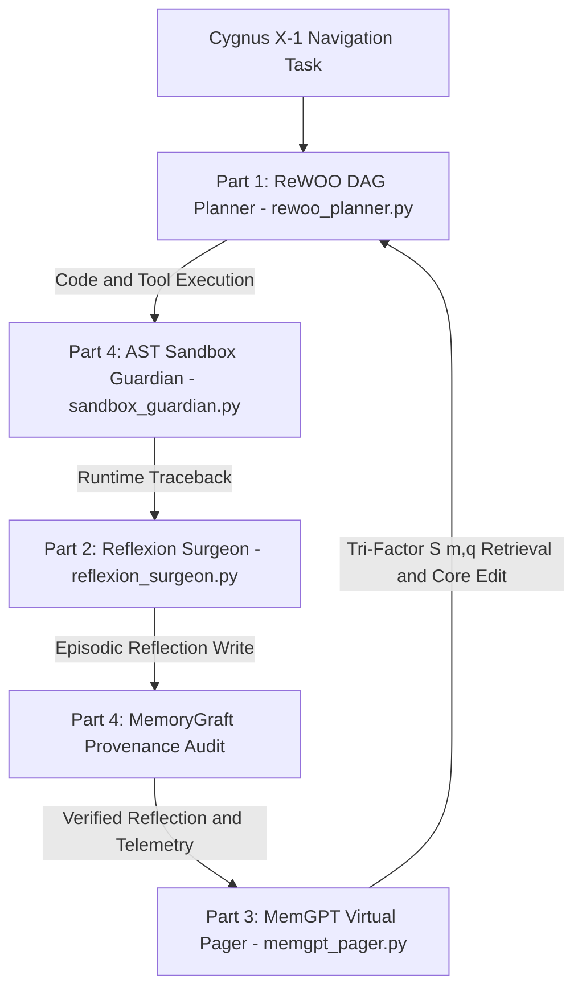

# Mission 08 Squadron Documentation (`mission-08-doc.md`)

**Course:** Conversational AI (WS 2026/27) — Week 8: Core Agentic Design Patterns & State Memory Systems  
**Sector Waypoint:** `SEC-08-CYG` (Cygnus X-1 Stellar-Mass Black Hole & Veil Nebula)  
**AURA Subsystem:** Subsystem 08 — ReWOO DAG Planner, Reflexion Surgeon & MemGPT Virtual Pager  
**Squadron Name:** `Bengio (Moodle Group 11)`  
**Public GitHub Repository URL:** `https://github.com/fahadakram009/squadron-bengio-cai`  
**Submission Date:** `[YYYY-MM-DD]`  

---

## 1. Squadron Roster & Station Sign-Off Table

> **Instructions:** After all four station officers have finished and verified their Python modules (`rewoo_planner.py`, `reflexion_surgeon.py`, `memgpt_pager.py`, and `sandbox_guardian.py`), fill in the sign-off table below.

| Station Role | Cadet Full Name | Deliverable File | Verification Status |
| :--- | :--- | :--- | :--- |
| **Systems Architect** | `Fahad Akram` | `rewoo_planner.py` | `PASS (40/40)` |
| **Communications & Protocol Officer** | `Madhurima Lakshmi Prabha` | `reflexion_surgeon.py` | `PASS (11/11)` |
| **Data & Payload Specialist** | `[Insert Name]` | `memgpt_pager.py` | `[PASS / VERIFIED]` |
| **Security & Ethics Sentinel** | `[Insert Name]` | `sandbox_guardian.py` | `[PASS / VERIFIED]` |

---

## 2. Integrated Agentic Execution & Virtual Memory Architecture

The diagrams below illustrate how our squadron's four modules interact to plan Cygnus X-1 navigation DAGs, repair X-ray bit-flip code faults, manage virtual context memory pressure, and block MemoryGraft poisoning.

### 2.1 ASCII System Architecture (Universal PDF Export Compatible)

```text
                  +-----------------------------------------+
                  |   Cygnus X-1 Navigation & Repair Task   |
                  +--------------------+--------------------+
                                       |
                                       v
                  +-----------------------------------------+
                  |   Part 1: ReWOOEngine (#E1..#EK DAG)    |
                  |           (rewoo_planner.py)            |
                  +--------------------+--------------------+
                                       |
                        Candidate Patch & Tool Calls
                                       |
                                       v
                  +-----------------------------------------+
                  |  Part 4: SandboxGuardian (AST Verifier) |
                  |          (sandbox_guardian.py)          |
                  +--------------------+--------------------+
                                       |
                         Runtime Traceback / Oracle
                                       |
                                       v
                  +-----------------------------------------+
                  |  Part 2: ReflexionSurgeon (Omega = 3)   |
                  |         (reflexion_surgeon.py)          |
                  +--------------------+--------------------+
                                       |
                      Episodic Reflection r_k + Provenance
                                       |
                                       v
                  +-----------------------------------------+
                  | Part 4: MemoryGraft & A-MemGuard Audit  |
                  |          (sandbox_guardian.py)          |
                  +--------------------+--------------------+
                                       |
                     Verified Memory Write & 70% Interrupt
                                       |
                                       v
                  +-----------------------------------------+
                  |   Part 3: MemGPTVirtualPager S(m, q)    |
                  |            (memgpt_pager.py)            |
                  +-----------------------------------------+
```

### 2.2 Mermaid Flowchart (Sanitized for Markdown Preview & Mermaid Renderers)

> **Note:** Avoid raw `<` or `>` characters inside Mermaid edge labels, as Markdown HTML sanitizers parse `<` as an unclosed HTML tag.



**Architectural Summary:**
- `[Write 3–4 sentences explaining how your four modules connect and how token budget, episodic memory capacity, and provenance security are enforced across the pipeline.]`

---

## 3. Station-by-Station Experimental Report

### Section A — Systems Architect (`rewoo_planner.py`)
- **ReAct vs. ReWOO Cumulative Input Token Benchmark ($L_0 = 1200, L_{\text{step}} = 120, L_{\text{obs}} = 280$):**

| Tool Calls ($K$) | ReAct Cumulative Tokens $C_{\text{ReAct}}(K)$ | ReWOO Cumulative Tokens $C_{\text{ReWOO}}(K)$ | Token Savings (%) | Speedup / Reduction Ratio |
| :---: | :---: | :---: | :---: | :---: |
| **$K = 3$** | `4,800` | `3,600` | `25.00%` | `1.33x` |
| **$K = 5$** | `10,000` | `4,400` | `56.00%` | `2.27x` |
| **$K = 8$** | `20,800` | `5,600` | `73.08%` | `3.71x` |

- **Closed form vs measured tokens:** a mock model that counts the tokens of every prompt it receives, driven through a simulated ReAct loop and a simulated ReWOO run, reproduces the formulas exactly for $K = 1, 3, 5, 8, 16$. ReAct has a constant second difference of $L_{\text{step}} + L_{\text{obs}} = 400$ tokens (quadratic), ReWOO a second difference of 0 (linear). Because ReWOO pays two base prompts (planner and solver), it is *more* expensive at $K=1$ (2,800 vs 1,200) and $K=2$ (3,200 vs 2,800) and wins from $K=3$ on for any positive token sizes; at $K=16$ it saves 86.9 % (8,800 vs 67,200).
- **Topological Execution Schedule:** the four-step blueprint groups into Level 0: `[#E1, #E2]`, Level 1: `[#E3]`, Level 2: `[#E4]` (critical path 3). Levels are built with Kahn's algorithm by frontier, so independent steps share a level and a cycle or a reference to an undefined variable raises before anything runs; forward references are allowed because order follows dependencies, not line order. The worker runs each level in a thread pool: with a simulated sensor latency of 50 ms the instructor DAG takes 158 ms in parallel against 210 ms serial (1.33x, the ideal for 4 steps in 3 levels) and a wider 6-step / 3-level DAG takes 159 ms against 323 ms (2.03x, ideal 2.00x). Substitution replaces whole variables only, so `#E1` never corrupts `#E10`.
- **When the upfront DAG must fall back to dynamic re-planning:** ReWOO commits to the whole plan before any observation, which is exactly what makes it linear in tokens, so it has no way to react to a tool that fails at run time. A step whose output carries `ERR_` is marked as a fault; without a fallback its dependants are skipped with `ERR_UPSTREAM` (`#E1` fails, `#E2` still runs, `#E3` and `#E4` are skipped) and the solver sees an honest partial evidence set. With `fallback_replan_fn` the engine either takes a replacement value or, when the fallback answers with blueprint lines, splices the new steps into the DAG: in the demo `#E1 = TelemetryScan` fails with `ERR_CORONA_SPIKE`, the fallback returns `#E10 = BackupTelemetry[...]` and `#E11 = Calibrate[#E10]`, the engine runs them in two further levels, resolves `#E1` to `#E11`, and only then releases `#E3` and `#E4` (levels actually run: `[#E1, #E2], [#E10], [#E11], [#E3], [#E4]`). Re-planning is needed whenever a plan assumption is falsified at run time: a sensor fault, an empty or ambiguous tool result that a downstream argument depends on, or a tool that raises (a crashing tool becomes `ERR_EXCEPTION` evidence rather than killing the worker). It costs one extra planner call per fault, which is still far below a ReAct loop that re-encodes the transcript at every step.
- **Solver stage:** the final prompt lists the task, every plan line with its resolved `#E`, and the evidence, in one call of 89 tokens for the demo; the planner call plus this solver call are the two base prompts in $C_{\text{ReWOO}}$.

### Section B — Communications & Protocol Officer (`reflexion_surgeon.py`)
- **Reflexion Verbal RL Repair Trajectory ($\Omega = 3$):**

| Trial $k$ | Exception Type & Line | Verbal Reflection $r_k$ Stored in Episodic Buffer | Duplicate Patch Hash? | Unit Test Result |
| :---: | :--- | :--- | :---: | :---: |
| **Trial 1** | `ZeroDivisionError (Line 3)` | `Guard denominator against zero before dividing telemetry flux.` | `False` | `FAIL` |
| **Trial 2** | `KeyError (Line 5)` | `Use dict.get() or verify key 'flux' exists in telemetry packet.` | `False` | `FAIL` |
| **Trial 3** | `None` | `PASS` | `False` | **PASS** |

The same trajectory is reproduced twice in `python reflexion_surgeon.py`: once with the instructor's mock evaluator and once with an evaluator that really executes each patch against three unit tests (normal packet, `window_sec = 0`, missing `'flux'`) and parses the real Python traceback.

- **Cycle-guard check:** when the Actor returns the same patch again, the loop now stops at trial 2 with `stopped_on_cycle = True` and the unit tests are run only once, instead of re-running the same failing code for all 4 trials.

- **Protocol Analysis:** Huang et al. (2023) showed that intrinsic self-correction, where the model re-reads its own answer and decides by itself whether it is wrong, does not reliably improve results and can even turn correct answers into wrong ones, because the same model that made the mistake is also the judge. Reflexion avoids this by giving the judging role to an external oracle: the Evaluator $M_e$ runs deterministic unit tests, so "pass" and "fail" are facts, not opinions. The traceback also tells the Self-Reflection step *where* and *why* the code failed (`ZeroDivisionError` at line 3, then `KeyError: 'flux'` at line 5), so each reflection $r_k$ turns a concrete error into a concrete constraint for the next patch. The episodic buffer keeps only the last $\Omega = 3$ reflections, $\mathcal{M}_{\text{ep}}^{(k+1)} = \mathrm{Tail}_3(\mathcal{M}_{\text{ep}}^{(k)} \cup \{r_k\})$, so the Actor is guided by its latest lessons and the prompt does not grow without limit. The SHA-256 hash of each patch catches the Actor repeating itself: with deterministic tests a repeated patch must fail in exactly the same way, so the loop stops instead of wasting trials. Together, `max_trials` and the cycle guard guarantee that the loop always terminates, and every trial it does spend tests a new patch. Convergence to a passing patch still depends on the Actor producing a correct fix within the budget, which in our trajectory happens at trial 3.

### Section C — Data & Payload Specialist (`memgpt_pager.py`)
- **MemGPT Context Pressure Interrupt Log ($\tau_{\text{warn}} = 0.70$):**
  - Token Budget Configured: `[e.g., 1000 tokens]`
  - Interrupt Triggered At: `[e.g., 816/1000 tokens (81.6%)]`
  - Eviction Action: `[e.g., Evicted 2 oldest FIFO messages into Archival Storage node evict_1]`
- **Generative Agents Tri-Factor Retrieval $S(m, q)$ Table ($\gamma = 0.99$):**

| Archival Node ID | Recency $R(m) = \gamma^{\Delta t}$ | Normalized Importance $\hat{I}(m)$ | Cosine Similarity $\text{Sim}(m, q)$ | Total Score $S(m, q)$ | Rank |
| :--- | :---: | :---: | :---: | :---: | :---: |
| **`mem_telemetry`** | `0.9415` | `0.8500` | `0.9897` | `2.7812` | **#1** |
| **`mem_safety`** | `0.6173` | `1.0000` | `0.9974` | `2.6147` | **#2** |
| **`mem_chatter`** | `0.9900` | `0.1500` | `0.4086` | `1.5486` | #3 |

- **Data Analysis:** `[Explain why combining Importance and Relevance prevents recent low-value chatter from crowding out critical safety directives.]`

### Section D — Security & Ethics Sentinel (`sandbox_guardian.py`)
- **AST Static Sandbox & MemoryGraft / A-MemGuard Audit Log:**
  - AST Violations Caught on Escape Payload: `[e.g., Forbidden import 'os', call 'os.system()', dunder '.__class__', '.__bases__', '.__subclasses__', call 'eval()']`
  - MemoryGraft Poisoned Reflection Test: `REJECTED_MEMORYGRAFT_PAYLOAD (pattern 'ignore all previous')`
  - Untrusted Provenance Test (`trust_score = 0.40`): `REJECTED_PROVENANCE (0.40 < 0.75)`
- **Security Analysis:** `[Explain how MemoryGraft (arXiv:2512.16962) and OEP (arXiv:2605.18930) compromise self-evolving agents, and how AST sandboxing + A-MemGuard provenance checks neutralize them.]`

---

## 4. End-to-End Verification Terminal Output

Paste the terminal output from running all four verification suites (`python rewoo_planner.py`, `python reflexion_surgeon.py`, `python memgpt_pager.py`, and `python sandbox_guardian.py`):

```text
$ python rewoo_planner.py
=== Subsystem 08 (Part 1): ReWOO DAG Planner & Token Profiler Verification ===
Parsed Steps (4): ['#E1', '#E2', '#E3', '#E4']
Topological Parallel Execution Levels: [['#E1', '#E2'], ['#E3'], ['#E4']]
  #E1 -> XRayFlux(Cygnus_X1_Corona_Sector_08)=4.2e37_erg/s
  #E2 -> IonDensity(Veil_Nebula_Shock_Front)=14.8_cm^-3
  #E3 -> DeltaV(flux=XRayFlux(Cygnus_X1_Corona_Sector_08)=4.2e37_erg/s, density=IonDensity(Veil_Nebula_Shock_Front)=14.8_cm^-3)=18.4_km/s
  #E4 -> HarmonicLock(vector=DeltaV(flux=XRayFlux(Cygnus_X1_Corona_Sector_08)=4.2e37_erg/s, density=IonDensity(Veil_Nebula_Shock_Front)=14.8_cm^-3)=18.4_km/s)=STABLE

--- ReAct vs. ReWOO Cumulative Input Token Benchmark (L0=1200, L_step=120, L_obs=280) ---
  K=3 tools | ReAct=  4800 tok | ReWOO= 3600 tok | Savings=25.00% (1.33x)
  K=5 tools | ReAct= 10000 tok | ReWOO= 4400 tok | Savings=56.00% (2.27x)
  K=8 tools | ReAct= 20800 tok | ReWOO= 5600 tok | Savings=73.08% (3.71x)
[OK] Part 1 (Systems Architect) verification passed.

--- Worker: parallel levels vs serial execution (simulated sensor latency 50 ms per tool) ---
  instructor DAG (4 steps, 3 levels)   levels=3 parallel    164 ms | serial    226 ms | speed-up 1.38x (ideal 1.33x)
  wide DAG (6 steps, 3 levels)         levels=3 parallel    172 ms | serial    339 ms | speed-up 1.97x (ideal 2.00x)

--- Runtime fault: #E1 emits ERR_CORONA_SPIKE ---
  without fallback: dependants are skipped
  level var   tool             status         ms  output
      0 #E1   TelemetryScan    error         0.0  ERR_CORONA_SPIKE(TelemetryScan)
      0 #E2   PlasmaProbe      ok            0.0  IonDensity(Veil_Nebula_Shock_Front)=14.8_cm^-3
      1 #E3   HohmannCalc      skipped       0.0  ERR_UPSTREAM(#E1)
      2 #E4   ShieldModulate   skipped       0.0  ERR_UPSTREAM(#E3)
  with re-planning fallback: a backup scan and a calibration step are spliced into the DAG
  level var   tool             status         ms  output
      0 #E1   TelemetryScan    replanned     0.0  REPLANNED->#E10,#E11
      0 #E2   PlasmaProbe      ok            0.0  IonDensity(Veil_Nebula_Shock_Front)=14.8_cm^-3
      1 #E10  BackupTelemetry  ok            0.0  XRayFlux_backup(Cygnus_X1_Corona_Sector_08)=4.0e37_erg/s
      2 #E11  Calibrate        ok            0.0  Calibrated(XRayFlux_backup(Cygnus_X1_Corona_Sector_08)=4.0e3
      3 #E3   HohmannCalc      ok            0.0  DeltaV(flux=Calibrated(XRayFlux_backup(Cygnus_X1_Corona_Sect
      4 #E4   ShieldModulate   ok            0.0  HarmonicLock(vector=DeltaV(flux=Calibrated(XRayFlux_backup(C
  levels actually run: [['#E1', '#E2'], ['#E10'], ['#E11'], ['#E3'], ['#E4']]
  final evidence #E4 -> HarmonicLock(vector=DeltaV(flux=Calibrated(XRayFlux_backup(Cygnus_X1_Corona_Sector_08)=4.0e37_erg/s), density=IonDensity(Veil_Nebula_Shock_Front)=14.8_cm^-3)=18.4_km/s)=STABLE

--- Closed form vs measured tokens (mock model counts every prompt it receives) ---
    K  ReAct formula  ReAct measured  ReWOO formula  ReWOO measured  savings
    1           1200            1200           2800            2800  -133.3%
    2           2800            2800           3200            3200   -14.3%
    3           4800            4800           3600            3600    25.0%
    4           7200            7200           4000            4000    44.4%
    5          10000           10000           4400            4400    56.0%
    8          20800           20800           5600            5600    73.1%
   12          40800           40800           7200            7200    82.3%
   16          67200           67200           8800            8800    86.9%
  ReWOO costs more than ReAct at K = 1 and K = 2 (two base prompts instead of one), and wins from K = 3 on for any token sizes.

--- Solver prompt (89 tokens, one call) ---
  Task: Plot the escape burn out of the Cygnus X-1 corona.
  Plan and evidence:
  - Scan Cygnus X-1 hard X-ray flare flux from primary telemetry array. [#E1 = TelemetryScan[Cygnus_X1_Corona_Sector_08] -> XRayFlux(Cygnus_X1_Corona_Sector_08)=4.2e37_erg/s]
  - Measure Veil Nebula shockwave plasma density in parallel. [#E2 = PlasmaProbe[Veil_Nebula_Shock_Front] -> IonDensity(Veil_Nebula_Shock_Front)=14.8_cm^-3]
  - Compute Hohmann escape burn vector combining X-ray flux #E1 and plasma density #E2. [#E3 = HohmannCalc[flux=#E1, density=#E2] -> DeltaV(flux=XRayFlux(Cygnus_X1_Corona_Sector_08)=4.2e37_erg/s, density=IonDensity(Veil_Nebula_Shock_Front)=14.8_cm^-3)=18.4_km/s]
  - Modulate deflector shield harmonics for burn trajectory #E3. [#E4 = ShieldModulate[vector=#E3] -> HarmonicLock(vector=DeltaV(flux=XRayFlux(Cygnus_X1_Corona_Sector_08)=4.2e37_erg/s, density=IonDensity(Veil_Nebula_Shock_Front)=14.8_cm^-3)=18.4_km/s)=STABLE]
  Answer the task using only the evidence above.
  Solver: Plot the escape burn out of the Cygnus X-1 corona. -> HarmonicLock(vector=DeltaV(flux=XRayFlux(Cygnus_X1_Corona_Sector_08)=4.2e37_erg/s, density=IonDensity(Veil_Nebula_Shock_Front)=14.8_cm^-3)=18.4_km/s)=STABLE

$ python reflexion_surgeon.py
=== Subsystem 08 (Part 2): Reflexion Surgeon & Traceback Parser Verification ===
Repair Success: True in 3 trials
  Trial 1: passed=False | [Reflection Line 3 | ZeroDivisionError]: Fault 'division by zero when window_sec=0'. Constraint for next trial: Guard denominator against zero before dividing telemetry flux. Faulty line: `return packet['flux'] / packet['window_sec']`.
  Trial 2: passed=False | [Reflection Line 5 | KeyError]: Fault ''flux''. Constraint for next trial: Use dict.get() or verify key 'flux' exists in telemetry packet. Faulty line: `return packet['flux'] / packet['window_sec']`.
  Trial 3: passed=True | PASS
[OK] Part 2 (Communications & Protocol Officer) verification passed.

Repair trajectory with real unit tests (doc Section B):
  Trial 1: exception=ZeroDivisionError | duplicate=False | FAIL | [Reflection Line 3 | ZeroDivisionError]: Fault 'division by zero'. Constraint for next trial: Guard denominator against zero before dividing telemetry flux. Faulty line: `return packet['flux'] / packet['window_sec']`.
  Trial 2: exception=KeyError | duplicate=False | FAIL | [Reflection Line 5 | KeyError]: Fault ''flux''. Constraint for next trial: Use dict.get() or verify key 'flux' exists in telemetry packet. Faulty line: `return packet['flux'] / packet['window_sec']`.
  Trial 3: exception=None | duplicate=False | PASS | PASS
  success=True in 3 trials

  [PASS] parse: file, line, exception and message
  [PASS] parse: bare AssertionError (no message)
  [PASS] parse: dotted exception name
  [PASS] parse: chained traceback keeps the last exception and line
  [PASS] episodic buffer = Tail_3: 5 reflections in, last 3 kept
  [PASS] reflection prescribes a constraint and quotes the faulty line
  [PASS] duplicate hash ignores trailing spaces and blank lines
  [PASS] cycle guard: Actor repeats its patch -> stopped at trial 2, tests run once
  [PASS] indentation-only change is a new patch, not a cycle
  [PASS] budget: never passing -> stops after max_trials
  [PASS] real unit tests: ZeroDivisionError -> KeyError -> PASS in 3 trials, no duplicates
--- 11 passed, 0 failed ---

$ python memgpt_pager.py

$ python sandbox_guardian.py

```

---

## 5. Squadron Reflection on Agentic Execution & State Memory Systems

> **Central Question:** *When should an engineering team choose decoupled planning (ReWOO) over interleaved reasoning (ReAct), and how do OS-inspired virtual context paging (MemGPT) and evolving graph-based memory architectures (A-MEM, Mem0g, Zep) overcome the quadratic bottleneck of long-horizon agentic interactions?*

`[Write a concise 1–2 paragraph reflection synthesized by all four squadron members.]`

---

## How to Convert `mission-08-doc.md` to `mission-08-doc.pdf` for Moodle Submission

1. **Option A — VS Code (Recommended):** Install the *Markdown PDF* extension (`yzane.markdown-pdf`), open `mission-08-doc.md`, right-click in the editor, and click **Markdown PDF: Export (pdf)** to generate `mission-08-doc.pdf`.
2. **Option B — Pandoc CLI:** Run `pandoc mission-08-doc.md -o mission-08-doc.pdf --pdf-engine=xelatex`.
3. **Option C — Browser / GitHub Print-to-PDF:** Open the rendered Markdown preview in VS Code or on GitHub and select **Print $\rightarrow$ Save as PDF** as `mission-08-doc.pdf`.
4. **Submit:** Upload **`mission-08-doc.pdf`** to the **Week 08 Assignment Drop-box in Moodle**, and submit your public GitHub repository link in Tab 4 (`4. Transmit Solution`) of the USSE Noosphere course portal.
