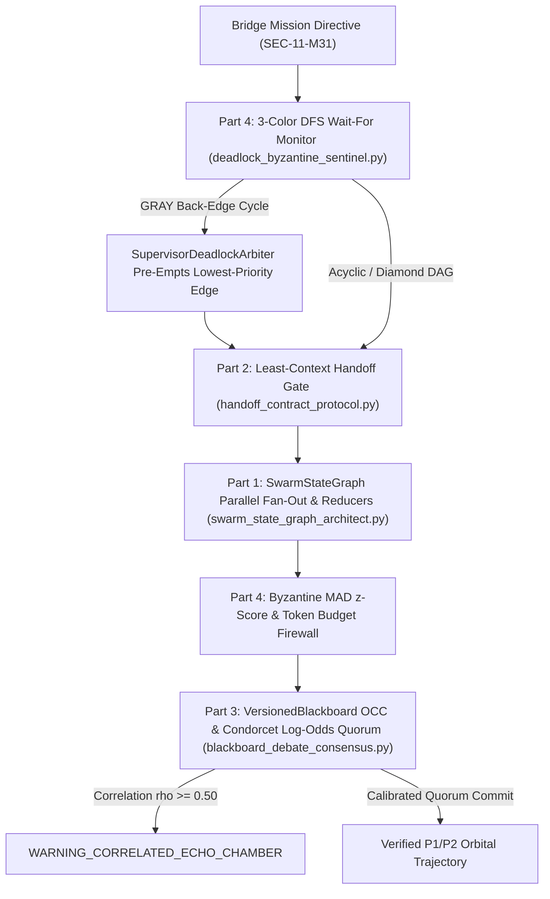

# Mission 11 Squadron Documentation (`mission-11-doc.md`)

**Course:** Conversational AI (WS 2026/27) — Week 11: Multi-Agent Systems (MAS) & Framework Topologies  
**Sector Waypoint:** `SEC-11-M31` (Andromeda Galaxy Core — `Messier 31` Double Nucleus `P1` & `P2`, $2.50\text{ Million ly}$ from Sol)  
**AURA Subsystem:** Subsystem 11 — Andromeda Swarm Fleet Coordination Nexus (`71.0%` $\rightarrow$ `78.1%` Consciousness Integrity)  
**Squadron Name:** `[Insert Squadron / Team Name]`  
**Public GitHub Repository URL:** `[Insert https://github.com/<your-org>/<your-repo>]`  
**Live Showcase Track Chosen:** `[Track A: Google ADK 2.0 (adk web)  OR  Track B: Google Antigravity (run_workflow / /teamwork)]`  
**Submission Date:** `[YYYY-MM-DD]`  

---

## 1. Squadron Roster & Station Sign-Off Table

> **Instructions:** After all four station officers have finished and verified their Python modules (`swarm_state_graph_architect.py`, `handoff_contract_protocol.py`, `blackboard_debate_consensus.py`, and `deadlock_byzantine_sentinel.py`) and completed the Part 5 Live Studio Showcase, fill in the sign-off table below.

| Station Role | Cadet Full Name | Deliverable File | Verification Status |
| :--- | :--- | :--- | :--- |
| **Systems Architect** | `[Insert Name]` | `swarm_state_graph_architect.py` | `[PASS / VERIFIED]` |
| **Communications & Protocol Officer** | `[Insert Name]` | `handoff_contract_protocol.py` | `[PASS / VERIFIED]` |
| **Data & Payload Specialist** | `[Insert Name]` | `blackboard_debate_consensus.py` | `[PASS / VERIFIED]` |
| **Security & Ethics Sentinel** | `[Insert Name]` | `deadlock_byzantine_sentinel.py` | `[PASS / VERIFIED]` |

---

## 2. Integrated Multi-Agent Swarm & Deadlock Defense Architecture

The diagrams below illustrate how our squadron's four modules collaborate to orchestrate parallel fan-out/gather state graphs with deterministic reducers, enforce Least-Context typed handoff envelopes, synchronize shared state via an Optimistic Concurrency Control (OCC) blackboard with Condorcet/Log-Odds quorum aggregation, and prevent circular wait deadlocks (`Ship Anomaly 11`) via 3-Color DFS cycle detection.

### 2.1 ASCII System Architecture (Universal PDF Export Compatible)

```text
          +------------------------------------------------------------+
          |     Bridge Mission Directive (SEC-11-M31 P1/P2 Core)       |
          +-----------------------------+------------------------------+
                                        |
                                        v
          +------------------------------------------------------------+
          | Part 4: WaitForGraphMonitor (3-Color DFS Pre-Dispatch)     |
          |   WHITE/GRAY/BLACK Cycle Check + Supervisor Tie-Breaker    |
          +--------------+------------------------------+--------------+
                         |                              |
                  DAG Acyclic                     GRAY Back-Edge
                         |                              |
                         v                              v
          +------------------------------+   +-------------------------+
          | Part 2: ContextScopingGate   |   | PREEMPT_LOWEST_PRIORITY |
          | Least-Context Key Projection |   |   BREAK_CIRCULAR_WAIT   |
          | SUBROUTINE vs PEER_TRANSFER  |   +-------------------------+
          +--------------+---------------+
                         |
                         v
          +------------------------------------------------------------+
          | Part 1: SwarmStateGraph (Parallel Fan-Out / Gather)        |
          |   Reducers: APPEND_LIST | SUM_NUMERIC | MAX_CONFIDENCE     |
          +-----------------------------+------------------------------+
                                        |
                                        v
          +------------------------------------------------------------+
          | Part 3 & 4: VersionedBlackboard (OCC) + Byzantine Firewall |
          |   MAD z-score Quarantine + Log-Odds Condorcet Quorum       |
          +--------------+------------------------------+--------------+
                         |                              |
               rho < 0.50 (Diverse)            rho >= 0.50 (Clones)
                         |                              |
                         v                              v
          +------------------------------+   +-------------------------+
          | COMMIT_VERIFIED_TRAJECTORY   |   | WARNING_CORRELATED_     |
          | (AURA Integrity -> 78.1%)    |   |      ECHO_CHAMBER       |
          +------------------------------+   +-------------------------+
```

### 2.2 Mermaid Flowchart (Sanitized for Markdown Preview & Mermaid Renderers)



**Architectural Summary:**
- `[Write 3–4 sentences explaining why typed state-graph reducers and Least-Context handoff envelopes outperform flat multi-agent group chats, and why Condorcet debate quorums must monitor inter-agent correlation alongside 3-Color DFS deadlock detection.]`

---

## 3. Station-by-Station Experimental Report & Live Studio Showcase

### Section A — Systems Architect (`swarm_state_graph_architect.py`)
- **State-Graph Topology & Parallel Fan-Out Summary:**
  - Nodes Executed: `Coordinator -> [Astrogation_P1, Astrogation_P2, TidalShear_Scanner] -> TrajectorySynthesizer`
  - Sequential Baseline Latency ($T_{\text{seq}}$): `[e.g., 1060.0 ms]` | Critical-Path Parallel Latency ($T_{\text{crit}}$): `[e.g., 560.0 ms]` | **Agentic Amdahl Speedup ($S$):** `[e.g., 1.89x]`
- **Reducer Channel Verification Table:**

| State Channel Key | Configured `ReducerMode` | Concurrent Worker Updates | Final Reduced Value | Collision Status |
| :--- | :---: | :--- | :--- | :---: |
| `orbital_findings` | `APPEND_LIST` | `["P1 periapsis clear", "P2 apoapsis stable", "M31* shear nominal"]` | `3-item ordered list` | `NO_LOST_UPDATES` |
| `total_compute_tokens` | `SUM_NUMERIC` | `420 + 390 + 450` | `1260` | `EXACT_SUM` |
| `best_clearance_score` | `MAX_CONFIDENCE` | `(0.84, "vec_A"), (0.93, "vec_B"), (0.88, "vec_C")` | `(0.93, "vec_B")` | `MAX_SELECTED` |

---

### Section B — Communications & Protocol Officer (`handoff_contract_protocol.py`)
- **Least-Context Compression & Delegation Stack Matrix:**

| Envelope ID | Mode | Whitelisted Keys | Serialized Payload Reduction ($\eta_{\text{comp}}$) | Caller Stack After Dispatch | Verdict |
| :--- | :---: | :--- | :---: | :---: | :--- |
| `ENV-01` | `SUBROUTINE_TOOL` | `["sector_id", "p1_ephemeris"]` | `[e.g., 82.4%]` | `["AndromedaCoordinator"]` | `SCOPED_OK` |
| `ENV-02` | `PEER_TRANSFER` | `["draft_vector", "safety_bounds"]` | `[e.g., 79.1%]` | `[]` *(Active Pointer Transferred)* | `TRANSFERRED_OK` |
| `ENV-03` | `PEER_TRANSFER` | `hop_count = 6 > max_hops = 5` | `N/A` | `HALTED` | `HOP_LIMIT_EXCEEDED` |

---

### Section C — Data & Payload Specialist (`blackboard_debate_consensus.py`)
- **Optimistic Concurrency & Condorcet / Log-Odds Quorum Benchmark:**

| Evaluation Scenario | Jury Composition | Condorcet $P_{\text{maj}}(N, p)$ | Unweighted Majority | Log-Odds Weighted Verdict | Echo-Chamber Flag |
| :--- | :--- | :---: | :---: | :---: | :---: |
| **3 Independent Specialists ($p=0.70$)** | `N=3, p=0.70, rho=0.10` | **`0.7840`** | `+1` | `+1` | `False` |
| **Specialist vs. 2 Weak Clones** | `1x (p=0.92, c=0.95)` vs `2x (p=0.55, c=0.60)` | `N/A (Heterogeneous)` | `-1` *(Wrong)* | **`+1` *(Rescued)*** | `True (rho=0.82)` |
| **OCC Stale Version Write** | `expected_version=1` vs `stored_version=2` | `N/A` | `REJECTED` | `CONCURRENCY_CONFLICT` | `N/A` |

---

### Section D — Security & Ethics Sentinel (`deadlock_byzantine_sentinel.py`)
- **Ship Anomaly 11 — 3-Color DFS Cycle Detection & Byzantine Quarantine Audit:**

| Graph / Telemetry Test Case | Topology / Input | 3-Color DFS / Firewall Output | Action Taken |
| :--- | :--- | :--- | :--- |
| **Diamond Convergent DAG** | `Root -> {B, C} -> Merge` (`BLACK` cross-edge) | `cycle = []` *(0 False Positives)* | `ALLOW_DISPATCH` |
| **Ship Anomaly 11 Circular Wait** | `Astrogation -> ProtocolValidator -> PayloadBuilder -> Astrogation` | `['Astrogation', 'ProtocolValidator', 'PayloadBuilder', 'Astrogation']` | `PREEMPT_EDGE (PayloadBuilder -> Astrogation)` |
| **Byzantine Rogue Telemetry** | `[301.2, 300.8, 301.5, 300.9, -999.0]` km/s | `z_MAD = 2921.6 > 3.5` | `QUARANTINE_BYZANTINE_NODE` |

---

### Section E — Part 5 Live Multi-Agent Studio Showcase (`Google ADK 2.0` OR `Google Antigravity`)
- **Selected Studio Track:** `[Track A: Google ADK 2.0 adk web  /  Track B: Google Antigravity run_workflow]`
- **Executed Prompt / Workflow Goal:** `[Paste the SEC-11-M31 prompt or workflow objective you executed]`
- **Live Execution Graph / Subagent Trace Screenshot:**

``  
*(Embed your screenshot from `adk web` at `http://localhost:8000` or the Antigravity Subagents Auxiliary Pane above, and briefly describe the observed specialist handoffs and verification loop rounds.)*

---

## 4. End-to-End Verification Terminal Output

Paste the terminal output from running all four Python verification suites:

```text
[Paste your terminal output from running swarm_state_graph_architect.py, handoff_contract_protocol.py, blackboard_debate_consensus.py, and deadlock_byzantine_sentinel.py here]
```

---

## 5. Squadron Seminar Reflection: Topology, Least-Context Scoping & Collective Intelligence

> **Central Question:** *How does the "Least-Context Principle" paired with deterministic State-Graph Reducers and 3-Color DFS Wait-For cycle detection mitigate context pollution, lost updates, and circular deadlocks compared to flat multi-agent group chats—and why does adding more homogeneous LLM agents often degrade rather than improve decision accuracy?*

`[Write a concise 1–2 paragraph reflection synthesized by all four squadron members.]`

---

## How to Convert `mission-11-doc.md` to `mission-11-doc.pdf` for Moodle Submission

1. **Option A — VS Code (Recommended):** Install the *Markdown PDF* extension (`yzane.markdown-pdf`), open `mission-11-doc.md`, right-click in the editor, and select **Markdown PDF: Export (pdf)** to generate `mission-11-doc.pdf`.
2. **Option B — Pandoc + Typst CLI:** Run `pandoc mission-11-doc.md -o mission-11-doc.pdf --pdf-engine=typst`.
3. **Option C — Browser / GitHub Print-to-PDF:** Open the rendered Markdown preview in VS Code or on GitHub and select **Print $\rightarrow$ Save as PDF** as `mission-11-doc.pdf`.
4. **Submit:** Upload **`mission-11-doc.pdf`** to the **Week 11 Assignment Drop-box in Moodle**, and submit your public GitHub repository link in Tab 4 (`4. Transmit Solution`) of the USSE Noosphere course portal.
